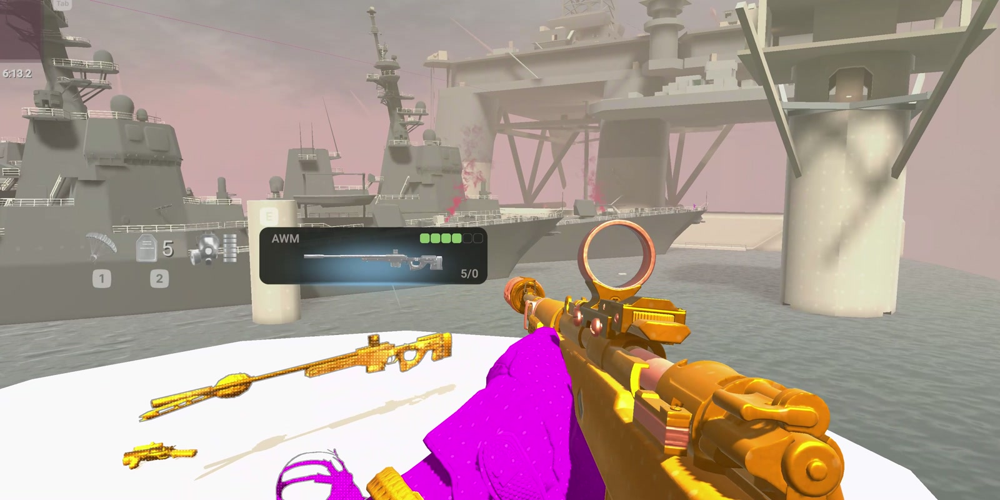
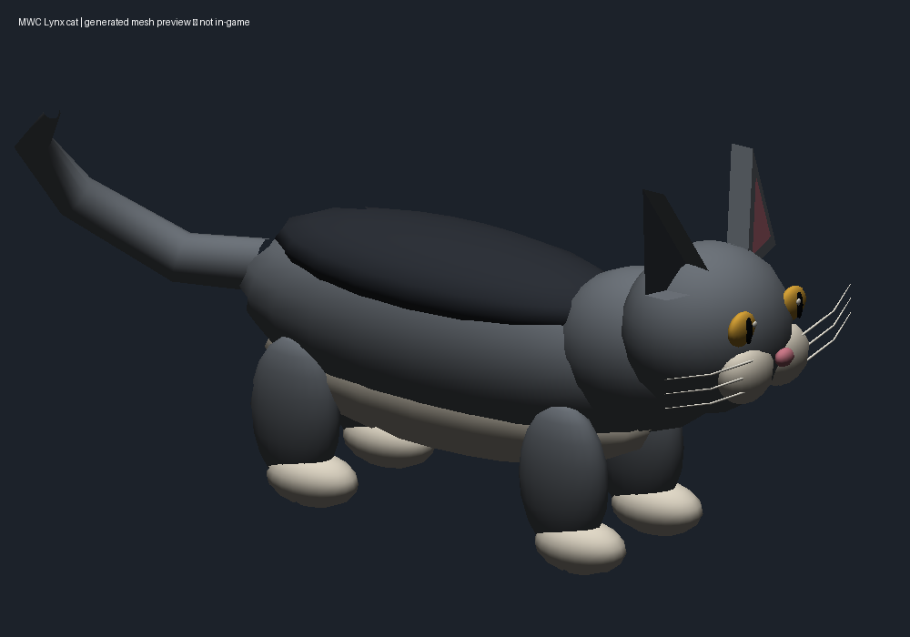
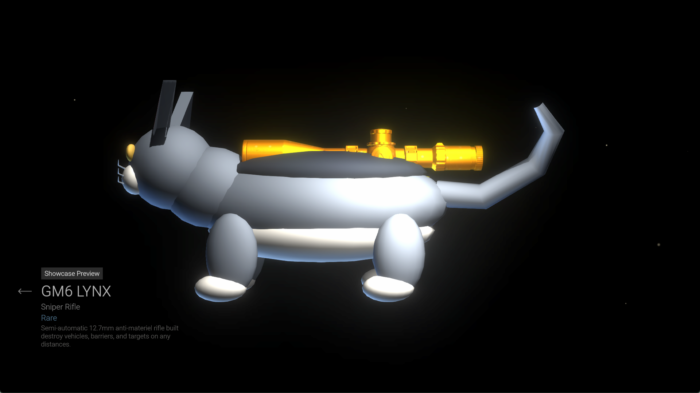

# Combat Master MWC (Magenta War Crimes)

Native Linux visual-asset experiments for **Combat Master**: deterministic
halftone retextures, an M1A0 ginger Lynx cat gun, authored weapon replacements, sky cubemaps, character replacements, and offline sight customization through an FT mod manager.



The screenshot comes from user-recorded gameplay. It demonstrates the
retexture work, not the cat prototype. More captures are in
[the screenshot gallery](docs/screenshots/README.md).

## Current state

| Feature | State |
| --- | --- |
| Fine / Quiet Light-Dot Halftone | Implemented and applied locally; gameplay captures available |
| Authored weapon upgrades | Scorpion, fishing rod, toaster and MP7 power nailer installed/file-verified. Local TF2 Medigun visual also installed. Native offline armory/showcase appearance checked for Scorpion, rod, nailer and toaster; ADS/reload and Medigun world appearance pending. |
| Minecraft-style sky | Independent sky-only module; v0.1.3 includes expanded coverage. Installed native Parvis check shows square clouds alongside the existing halftone terrain. Six-sided maps, sun/moon and broader exposure review remain pending. |
| Operator expansion | Dozer/Shrek retained; magenta Ranger now uses the armored human Grapple. Female Pulse Blade and legacy Stim remain independent choices. Matching slimmer arms and matte materials are installed. Fishguy, all nine TF2 mercenaries, Mario and Steve are optional per-operator choices. Native menus and stationary Grapple arms checked; full animation, ADS/reload and helicopter acceptance pending. |
| FT mod manager | Individual cards, previews, per-operator assignments and independent magenta controls; verified backups/transactions. Linux UI tested; Windows VM UI/preferences/runtime checked; Windows game edits untested. |
| Shared albedo separation | Implemented with category-specific copies and verified material bindings |
| Map texture arrays | Implemented for the four inspected BC7 albedo arrays, 50 layers |
| Lynx cat geometry | Actual M1A0 ginger cat imported locally; original tail and full body preserved |
| Lynx bundle prototype | M1A0 v5 installed; full rear body/tail visible in native armory; current first-person testing pending |
| Procedural fallback | Earlier gray-cat showcase verified; source OBJ/GLB remains available |
| Cat firing, reload, ADS and muzzle alignment | **Not verified**; isolated guest profile has the weapon locked |
| Bright blue CombatZone loot crates | Three materials installed and file-verified; world appearance not yet tested |
| Steg Spikes visual replacement | Conventional notch and post installed; game-visible alignment unverified |
| Reticle pictures | 38 changed to Sun; seven requested names preserved |
| Helicopter glass | Little Bird window material cleared across 21 render bindings; file-verified, visual testing pending |
| Lynx cat audio | Seven shot/reload/bolt samples replaced with addon cat noises; exact PCM/FMOD round-trip, in-game audition pending |
| FOV management / crosshair overlay | Not implemented in this repository |

The inspected build is Steam **2281730**, build **24397779**, native Linux
Unity **6000.3.19f1 / IL2CPP**. Unknown builds stop at the version/hash guards.
There is no Mono loader, process injection, network modification or integrity
bypass. Use these experiments offline or in an explicitly authorized setup.

The v0.1.3 preview supports separately imported armored Grapple and female Pulse Blade pilots; see [native pilot import and test status](docs/titanfall-native-import.md). Public packages require prepared local pilot sources; the direct Steam decoder remains a separate development tool.

Current [Linux and Windows preview installers](https://github.com/aridlin/combat-master-MWC-magenta-war-crimes/releases) are available in Releases. Read the [native operator review](docs/operator-runtime-review.md) for material/headwear fixes, Fishguy wrist fitting and remaining deformation limits; each release identifies its source revision.

## Setup

Use Python 3.12, a native Linux Steam installation, and enough space for
original snapshots and staged bundles. Original game bundles are excluded; the installer builds from the user's own Steam files. Third-party assets retain their own licenses.

```sh
python3.12 -m venv .venv
.venv/bin/pip install -r requirements.txt
.venv/bin/python configure.py
.venv/bin/python -m unittest discover -s tests -v
```

`configure.py` finds Steam libraries and creates an ignored `halftone.json`.
If several installs exist, select one with `--library /path/to/SteamLibrary`.
To build from an existing original snapshot rather than an already modded
installation, add `--original-bundles /path/to/original/bundle/tree`.

## Halftone workflow

```sh
.venv/bin/python halftone_cli.py generate-textures
.venv/bin/python halftone_cli.py scan-assets
.venv/bin/python halftone_cli.py classify-assets
.venv/bin/python halftone_cli.py apply-textures --dry-run
.venv/bin/python halftone_cli.py apply-textures
.venv/bin/python halftone_cli.py apply-array-textures
.venv/bin/python halftone_cli.py separate-shared-albedos
.venv/bin/python halftone_cli.py verify-bundles
```

Review the classification and staged output before installing:

```sh
.venv/bin/python deploy_halftone.py install --dry-run
.venv/bin/python deploy_halftone.py install
# Restore the exact preinstall state:
.venv/bin/python deploy_halftone.py restore
```

Installation closes the identified game process, snapshots the installed
files, replaces verified bundles, and records hashes in a deployment journal.
It does not launch the game. Unknown installed hashes are rejected. The cat
prototype, sights and blue crate module must be restored before replacing the underlying halftone stack.

## Exact visual preset


Eight canonical RGB images use a 512×512 tile, regular square lattice,
32-pixel pitch, integer radius 3, and `np.rint(base + (255-base)*0.18)` dot
colors. Dots occupy exactly **2.83203125%** of the source. There is no noise,
Bayer matrix, source-luminance modulation, emission or baked lighting.

| Category | Base sRGB |
| --- | --- |
| Characters, arms and equipment | `#FF00FF` |
| Weapons and attachments | `#FF8500` |
| Vegetation | `#439B45` |
| Sheet metal | `#87939B` |
| Concrete | `#B5ADA0` |
| Wood | `#98663D` |
| Dirt/gravel | `#796B50` |
| Glass | `#65C9D6` |

Unknown props use an explicit neutral concrete fallback in the full-surface
preset. Mixed atlases/layers receive documented whole-surface approximations;
the tool does not infer semantic regions inside an atlas. UI, effects,
normals, masks, packed material maps and baked lighting remain separate.

The local full pass changed 5,234 albedos, added 11 category copies for six
shared sources, and changed 50 map-array layers across 76 bundles. These are
results for the inspected build, not portable fixed counts or universal
coverage guarantees for later builds/runtime downloads.

Original UVs and material tiling determine physical scale. The requested
1.28-meter tile is **not** a measured world-space result. Compression,
filtering and lighting introduce colors beyond the two exact source RGBs.
RGBA array conversion preserves every decoded alpha mip but adds about
176 MiB of texture storage. Frame-time/VRAM behavior has not been measured.

## Actual M1A0 ginger Lynx

The current local model is the actual M1A0 ginger cat, imported from the
user's Steam addon. Its full original body and tail are retained. The
third-party source assets are kept local. See [local import instructions and
credits](docs/m1a0-local-import.md). Current v5 hipfire, ADS and reload placement
remain unverified; the earlier gray-cat screenshot below is a fallback test.

## Sight customization

Steg Spikes receives a conventional rear notch/front post at its existing aim
point. Thirty-eight reticle pictures use Sun; Red Dot, Red Arrow, Toxic Tris,
Blue Dot, Circle Dot, Sun and Pulse are preserved. See [build, installation,
verification and layered rollback](docs/sight-customization.md). Both sight
features are installed and file-verified, with game-visible testing pending.

## Lynx cat audio

The independent [audio module](docs/cat-audio.md) replaces only the Lynx's
seven existing shot/reload/bolt samples with cat sounds from the local M1A0
addon. Slot durations, event references, pitch and spatial settings remain
unchanged. No animation, weapon stats, firing or reload logic is modified.

## Helicopter windows

The Little Bird glass material contributes zero visible color/opacity across
21 render bindings, while body materials, frames, collision and scripts remain
unchanged. The separate module builds on the installed blue-crate baseline:

```sh
.venv/bin/python helicopter_windows.py prepare
.venv/bin/python helicopter_windows.py build
.venv/bin/python helicopter_windows.py verify
.venv/bin/python helicopter_windows.py install
.venv/bin/python helicopter_windows.py restore
```

Actual in-game window visibility is still unverified. Restore helicopter
windows before the blue crate module. Full layer order is recorded in
[the current rollback guide](docs/restoration.md).

## Four original weapon models

The Scorpion Evo now has a scorpion model, Kar98k a fishing rod, MP7 a nail gun,
and P90 a toaster. These original rigid visual prototypes are installed and
file-verified. Their geometry and palettes are exported as OBJ and standalone
GLB. See [previews, build instructions and rollback](docs/weapon-models.md).

Actual hipfire/ADS placement, animation appearance and first/third-person/LOD
transitions remain unverified. Shared sights are retained; original game
meshes, collision, scripts, animations, audio and weapon stats stay intact.
Each model can be independently selected when building a fresh variant.

## Other weapon concepts

[The model shortlist](docs/weapon-model-ideas.md) records the implemented four
prototypes plus remaining goose, plunger and other visual concepts. Those
remaining concepts are not implemented.

## Original procedural fallback cat



The original cat has **3,690 vertices and 7,106 triangles**. It is attached
as a separate rigid visual child to both inspected Lynx roots. Dedicated
empty render-mesh copies replace 111 Lynx-specific render bindings, and all
Lynx-specific renderers are disabled, including initially empty renderers
that the game populates at runtime. The original
meshes remain available to collision and other references. Shared optics
remain. Existing weapon bones, transforms, animations, sounds, scripts and
muzzle nodes keep their original data.

```sh
.venv/bin/python catgun_cli.py model
.venv/bin/python catgun_cli.py build
.venv/bin/python catgun_cli.py verify
# Explicitly opt into the offline prototype:
.venv/bin/python catgun_cli.py install --dry-run
.venv/bin/python catgun_cli.py install
.venv/bin/python catgun_cli.py restore
```

`catgun.json` controls position, quaternion rotation (x, y, z, w), and scale. Use a fresh output/backup directory
for a new variant. File-level verification checks the new vertex/normal/UV/
index data after reopening, all new local asset references, exact original
object bytes, and the narrow set of permitted visual changes.

The earlier procedural fallback rendered in the actual native Linux armory and showcase preview.
The first test caught a perpendicular cat and visible receiver/magazine;
subsequent builds corrected orientation and disabled runtime-populated visual
renderers. The shared scope intentionally remains.



**This remains a prototype.** Firing, reload, mouth/muzzle alignment,
scope/ADS clearance, first/third-person behavior and LOD transitions are
unverified. The network-isolated guest profile could preview the Lynx but
could not equip it because it is locked. No unlock/profile edits were made.
See [the native test record](docs/native-validation.md).

## Bright blue CombatZone crates

`crate-colors.json` selects bright blue `#008CFF` with the existing quiet dots.
The module gives the three `Box-1`, `Box-2`, and `Box-3` MilitaryCrate loot
materials dedicated albedo copies. Other users of the old textures retain
their existing colors. Alpha, normal maps, lighting, geometry, interaction
and loot data remain unchanged. Generic decorative boxes and store crates
are outside this selection.

Build the full halftone baseline first, then:

```sh
.venv/bin/python crate_colors.py build
.venv/bin/python crate_colors.py verify
.venv/bin/python crate_colors.py install --dry-run
.venv/bin/python crate_colors.py install
.venv/bin/python crate_colors.py restore
```

The three materials are installed and hash-verified locally. Their actual
appearance in the CombatZone map has not been visually tested. Restore both
crate and cat modules before restoring the underlying halftone installation.

## Layout

```text
halftone/              generation, asset scan, classification, encoding, verification
catgun/                original geometry, Unity mesh serialization, reversible deployment
assets/cat/            original OBJ, GLB, palette and clearly labeled previews
config/                portable palette/rules and inspected array-layer mapping
tests/                 deterministic pattern, classification, alpha, material and mesh tests
docs/screenshots/      curated stills from user-provided gameplay recordings
```

Game bundles, original backups, account-specific configuration, raw clips and
local scan reports are ignored. The MIT license covers original code and
procedural assets; the game and captured game content retain their own owners.

## 2026-11-03 expansion

Authored scorpion, fishing rod and toaster models replace three procedural weapon prototypes. The MP7 and Lynx are preserved. An independent Minecraft-style sky module changes only sky cubemap bindings. These builds passed file-level validation; in-game acceptance remains pending. Character work is blocked on authenticated source asset downloads and rigging/target validation. See [the expansion report](docs/expansion.md), [model attribution](assets/authored-weapons/ATTRIBUTION.md), and [installer instructions](installer/README.md).

Current operator/model status, source credits and acceptance limits are in [the operator expansion report](docs/operator-expansion.md). The source test suite has 75 tests: 74 pass, one existing data-dependent test is skipped. Color controls distinguish replacement models from unmodified in-game operator models; matching authored first-person arms are independently selectable (in-game grip testing pending).

Portable preview downloads: [Linux and Windows installers](https://github.com/aridlin/combat-master-MWC-magenta-war-crimes/releases/tag/v0.1.0-preview). Extract the whole archive. Public builds import your local M1A0 archive for Lynx/cat audio; TF2 models require local TF2.

Development source after v0.1.0 adds optional locally imported TF2 Medigun sounds and broader first-person arm coverage. These changes are not in the v0.1.0 downloads; see [current verification status](docs/operator-expansion.md) and [audio details](docs/tf2-audio.md).

Development source also includes independently selectable [local Audiojungle excerpts](docs/audiojungle-local-import.md), with explicit conflict handling against vanilla TF2 Medigun audio. Private build, Lynx preservation and exact deselection pass; in-game audition is pending. This addition is not included in the frontend-only v0.1.4-preview downloads.
