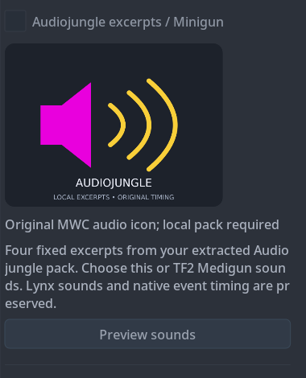

# Preview local sound packs

On **Extras**, supply your local TF2 installation or extracted Audiojungle
folder, then press **Preview sounds** on that pack's card. The card does not
need to be enabled. The installer exports the four processed native sound
slots and opens `preview.wav` in your default audio player. No Apply or offline
authorization checkbox is needed for this read-only operation. A running game
does not need to be closed.

The audition plays the three mapped firing clips followed by barrel spin,
with 0.3 seconds of silence between clips. This is a comparison sequence,
not a simulation of Combat Master's firing events or TF2's random sound
scripts. Volume in-game, rapid repetition, spatial processing and playback
performance still require actual game testing.

Preview and installation share the same slot decoder, local source reader,
resampling, RMS matching, peak limit and edge fades. The individual `01.wav`
through `04.wav` files retain exact processed PCM samples and their native
44.1 or 22.05 kHz rates. Only the combined audition upsamples the 22.05 kHz
spin slot to 44.1 kHz. `manifest.json` records the source hashes, clip names,
frame counts, processing analysis and audition timeline.

Files stay under the installer's private `audio-previews` state directory.
Each pack normally retains its latest two previews; an older file held open
by a player may remain until it can be removed. No source audio or generated
WAV is included in the public installer. The original source's terms still
apply to locally generated previews.

If the manager has an original audio backup, its recorded hash must match
before it can be used. Before the first installation, the game audio bundle
is read directly. Neither path snapshots, recovers or installs bundles, saves
new selections, changes operator assignments, closes the game, or launches it.
The shared state lock prevents a preview from racing an installation.

If the OS cannot open a player, the WAV remains available; the installer log
contains its path. Choose an audio player manually or configure the system's
WAV file association.

Validation and platform status are recorded in the preview verification report
once packaged client checks finish. Native in-game audition remains pending.
