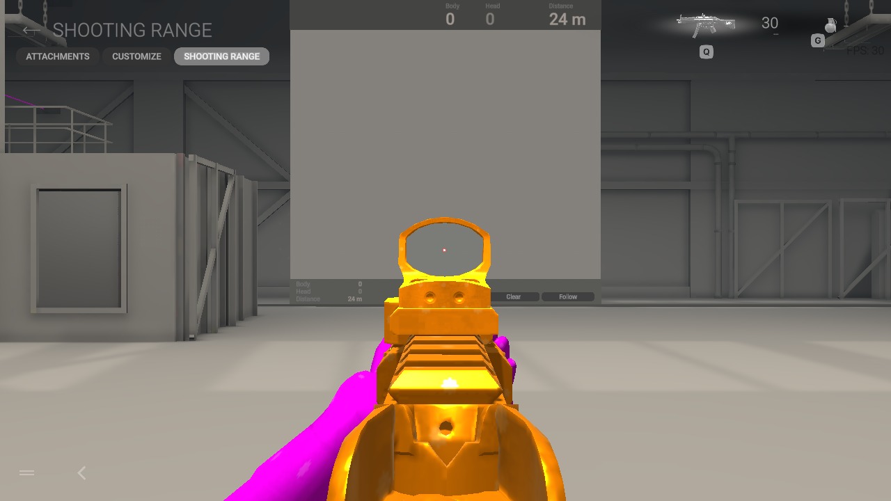
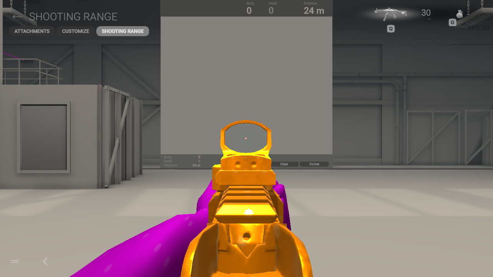

# Preserve fitted fingertips during viewmodel slimming

The source arm fitter now carries the native fingertip cap direction through
the later radius-reduction pass. Previously that pass reused the previous
finger joint's axis, moving an already fitted cap by up to 7.3 mm in the native
Ranger reference. This affects the nine TF2 arm options, whose hand radius is
reduced to 70%. Fishguy uses a hand radius of 100%; its positions and normals
remain byte-identical. Other operator models retain their existing fitting path.

The first direct axis substitution introduced extra reversed rest faces at
some authored finger transitions and was rejected. The implemented correction
keeps the old frame at the leaf base and blends to the cap frame using a
smoothstep along the distal segment. The normal transform includes the spatial
derivative of this blend. A finite-difference test checks that differential;
separate fixtures check the off-axis endpoint, radial reduction, protected base,
invalid input and byte-identical unit-scale/default paths.

Both native arm meshes for all nine TF2 classes pass source fitting and retain
their UVs, topology, skin indices and weights. Non-distal positions remain exact.
No new faces oppose their pre-radius geometric normal in these comparisons.
This is a scoped rest-shape diagnostic, not proof of a deformation-free mesh.
Existing crossings remain: Heavy removes six strict crossing pairs and adds
three; the other classes retain their previous crossing pairs. The check excludes
adjacent welded faces, coplanar overlap and boundary-only contact. The other
seven TF2 classes still need native review of this radius change.

## Native review and distribution

Fresh native Linux Vulkan stationary MP.V captures compare the original and
smooth Medic and Scout builds in hipfire, ADS and return to hipfire. The distal
thumb sits closer around the weapon in ADS; Scout's two protruding fingertip
lobes are mostly tucked behind it. The sight center stays clear. The authored
Medic open cuff and existing wrist issues remain. This is a localized grip
improvement, with full animation acceptance still open.

[The evidence index](fingertip-radius-verification.json) records all four paired
native runs, exact bundle/capture hashes, source comparisons and the rejected
abrupt-axis candidate. Native games exited 0; Gamescope teardown returned 139
separately. All four host-profile preservation checks passed.

The tests use the official empty range with copied guest profiles, network
isolation, no host display/audio, no movement or firing and unchanged installed
quality/player data. No private skin-quality override is used. These are actual
native game captures, not Editor renders or performance measurements.

This change is in the source authoring pipeline and private comparison bundles.
The public v0.1.9-preview installer and personal portable packages retain their
previous backend; they have not received this change. Installed game bundles,
selections and backups are unchanged. The source suite runs 181 tests: 180 pass
and one existing data-dependent test is skipped. Remaining work includes the
other TF2 native reviews, package validation, other weapons/attachments and full
animation testing.
The Fishguy wrist remains a separate investigation.
