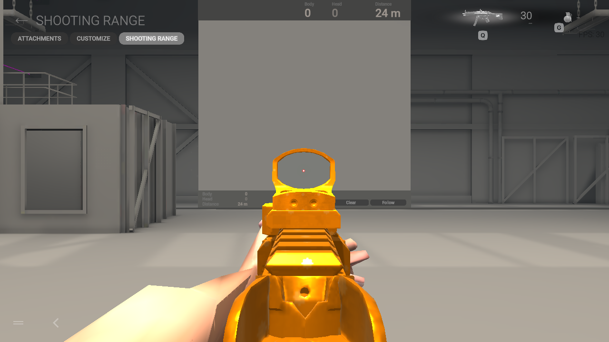
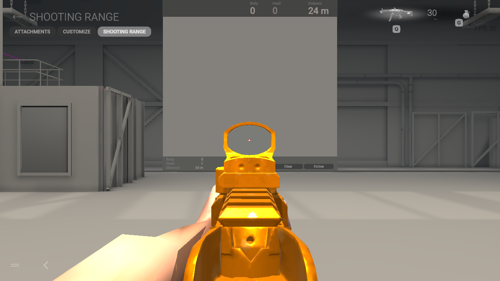
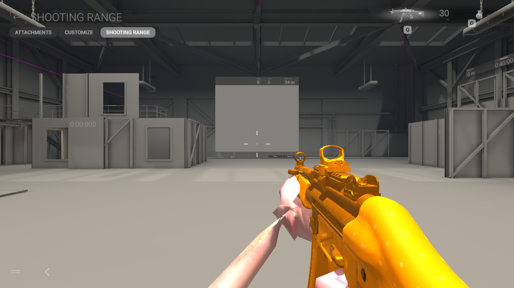
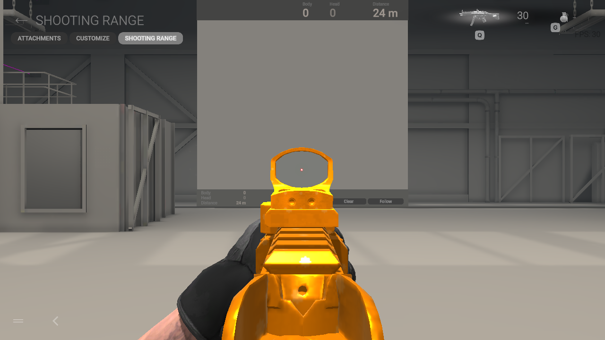
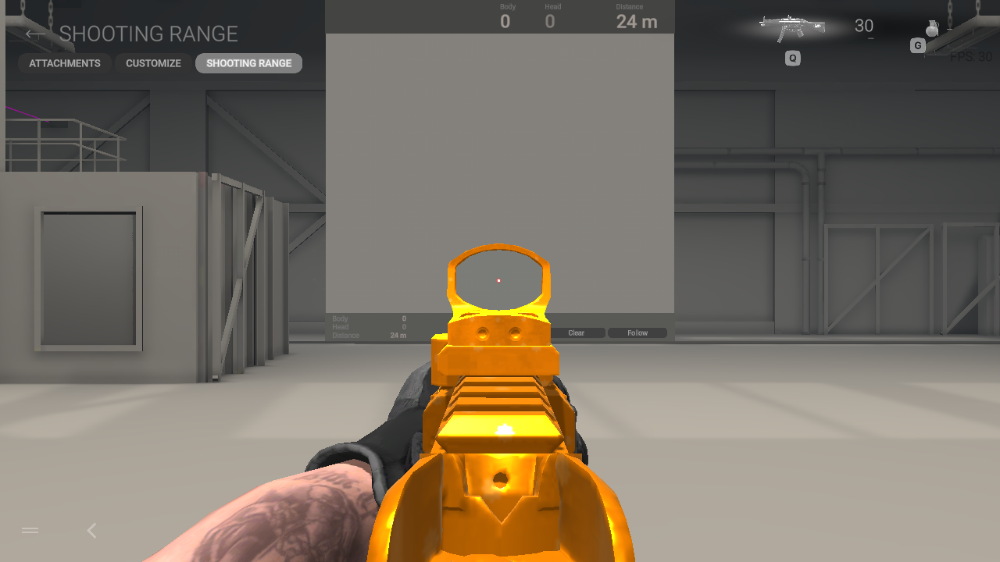
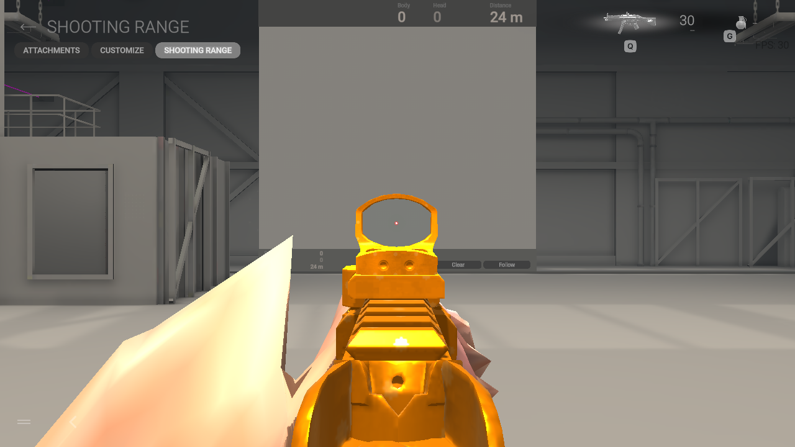
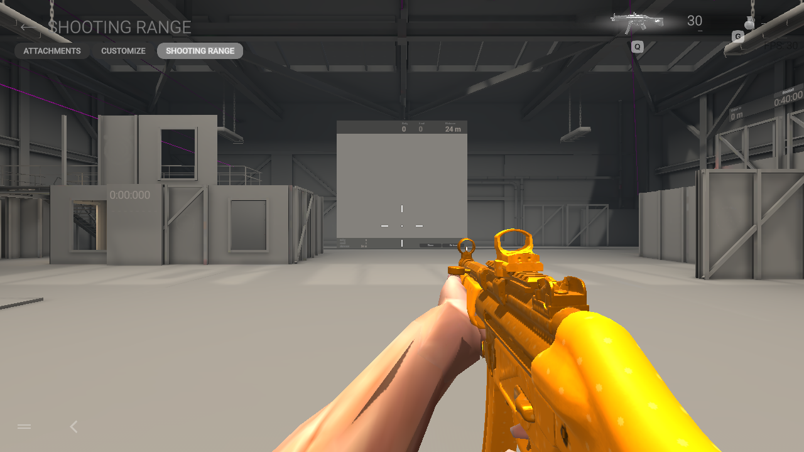
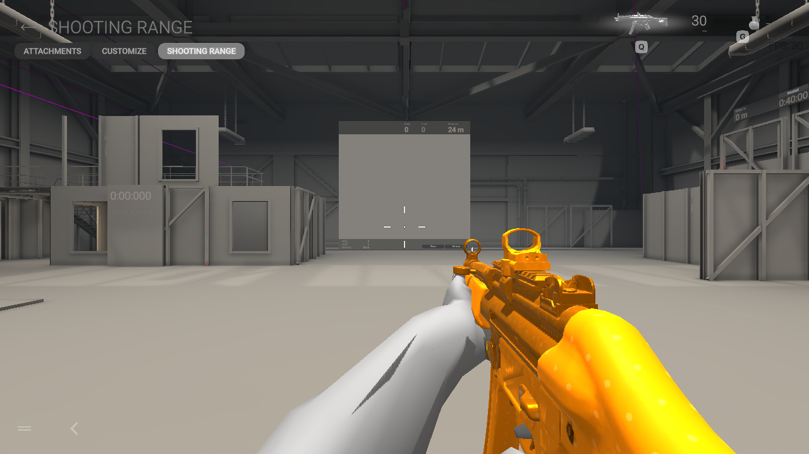
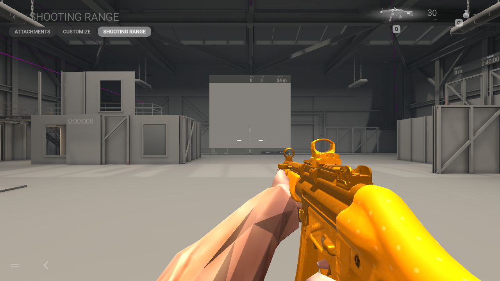

# Fishguy first-person controls

The native wrist crease remains unresolved. A separate fingertip correction is
now integrated in source for Fishguy and all nine TF2 classes after native stationary ADS
review; the rejected wrist and skin experiments below remain disabled. No new
bundle from this investigation is installed. Ranger remains the armored Grapple
pilot; Fishguy remains an optional assignment.

Fresh native stationary range controls narrowed the next investigation. The
[capture hashes and exit results](fishguy-native-control-verification.json) are
recorded separately:

| Private control | Observed result |
|---|---|
| Unmodified native first-person bundle | Original glove and forearm render cleanly |
| Native mesh and weights through the custom mesh writer | Clean native arm; the writer alone does not reproduce the Fishguy crease |
| Fishguy with only LOD0 enabled | Wrist crease remains |
| Fishguy with only LOD1 enabled | Arms are absent in this tested scene; hiding the other LOD does not solve the visible LOD0 problem |
| Direct hand-controller → wrist-twist weight remap | Palm stretching confirmed in the native runtime; rejected |
| Post-radius harmonic transition | Fold remains; rejected |
| Uniform joint fitting and smaller hands | Fold remains; rejected |
| Native triangle-surface weight transfer | Palm improves, forearm crease remains; rejected |
| Harmonic weight-field smoothing | Crease remains; rejected |
| Fourfold surface tessellation with authored weights | Crease remains; rejected |
| Dense native skin-field transfer | Wrist opening/crease remains; rejected |
| Anatomically selected native bare-forearm/hand skin field | Opening remains; rejected |
| Renderer skin quality explicitly set to four bones | Crease remains; rejected |
| Native longitudinal twist profile applied only to existing elbow weight | Thin overlapping-looking wrist lines less apparent in the captured view, but angular transition remains; partial diagnostic, not accepted |
| That twist split combined with the previous post-radius transition | Forearm seam remains; rejected |

The twist-only control retained all geometry, normals, UVs and palm/finger
influence masses. This narrows a possible forearm contribution without proving
a complete fix. The combined control's later attempt to open Attachments stayed
in the range; the evidence records uncertain delivery of that menu-target click
rather than claiming a no-input guarantee for the entire run. Subsequent range
QA sessions block menu clicks after entering the range.

## Direct ADS controls, November 6

The new bounded native pose check reveals protruding fingers around the weapon
in addition to the wrist problem. The existing anatomical native hand/forearm
weight-field candidate still shows that protrusion and a forearm opening. Both
keep the reticle clear in this single MP.V view, but neither earns grip or full
animation acceptance. [Capture hashes and limits](fishguy-native-pose-verification.json)
are recorded separately. These baseline and weight-field controls did not change
the installed game or production fitter. The later fingertip correction below
is a separate source change.

Two further retopology controls also failed before native testing. Keeping only
bare forearm/hand guide topology still opposed 235 of 3,163 projected face
normals; adding outward-normal matching reduced that to 178, still above the
unchanged 5% rejection guard. No failed projected mesh was launched.

An earlier full-guide native-topology projection was also rejected before launching the game:
7.8% of its projected faces opposed the reference normal. The fold guard was
retained. Rest-surface audits found no inconsistent weights at coincident
Fishguy vertices; this does not establish correct animated deformation.

These are bounded 1280×720 native Linux/Vulkan observations in a private guest
profile, with network access and host audio disabled. The original,
writer-roundtrip and two LOD controls exited the game with code 0 and retained the host profile
hashes. Gamescope teardown separately returned 139; these runs do not establish
long-session stability, performance or animation acceptance.

The original offline clip sampler separated hands on an unmodified native
glove control. A later native-Avatar comparison traced that false control
separation to the sampler's Euler rotation order and corrected it. The updated
isolated-clip sampler matches 2,880 Editor bone matrices, while runtime layers
and IK remain outside its scope. See [the comparison and limits](native-clip-review.md).
Native observations narrow the
problem toward imported geometry/retargeting/skin fitting, but do not identify a
single proven cause. Full movement, ADS, reloads and helicopter views remain
unaccepted.

## Fingertip correction, November 6

The full 3D native fingertip cap supplies a direction missing from leaf joints.
Fishguy uses its actual authored Finger4 endpoint; Medic uses the distal cap of
its genuine authored glove. Both retain source skin weights and native skeletons
and animations. The fingers now curl around the MP.V in the captured ADS view.
The Fishguy wrist seam remains. This is a localized improvement, not full grip
or animation acceptance.

The integrated bundles are byte-identical to the native-reviewed prototypes.
[Hashes, before/after captures and limits](finger-tip-native-verification.json)
are recorded separately. Axis-only endpoints were insufficient; native tips bend
in three dimensions. The third projected-topology control still opposed 164 of
3,163 faces and was rejected without relaxing the fold guard.

## Separate authored FPS-arm controls

WRAD ARMS by wriks is a proper 1,196-triangle, 50-joint FPS arm asset with a
CC0-1.0 license recorded in its downloaded README and license file. The GLB was
imported as data with automatic scripts disabled; the author's Blender file was
not loaded. [Author source](https://wriks.itch.io/wrad-arms).

Two private native controls retained the existing 80 native bones and used joint
fitting or additional palm fitting. The first still bunches at the wrist; the
second visibly folds more severely. Neither is accepted or integrated, and the
Fishguy world model remains unchanged. These results suggest a different asset
alone is insufficient, without establishing one cause.

[Capture hashes, licensing provenance and limits](wrad-arm-control-verification.json)
record both controls. No new model is silently substituted.

## Original-geometry binding controls, November 6

The mesh-writer control was repeated in stationary ADS and hipfire. The original
glove and forearm still look clean. Two inverse controls then kept the same
native geometry and numerical weights while changing only the selected skin
indices. Moving wrist-front-twist influences onto the hand controllers produces
a visible wrist/forearm bulge. Moving shoulder-twist influences onto shoulder
controllers does not reproduce that bulge in these views.

This confirms that the native palm drivers affect the rendered shape; it does
not establish a Fishguy repair or justify the previously rejected direct remap.
The controls do not cover upper-arm motion or a full animation set. All three
native game processes exited with code 0, retained host profile hashes and used
read-only installed assets. Gamescope teardown separately returned 139.
[Capture hashes and exact limits](native-binding-control-verification.json)
record the six reviewed images. An earlier menu-route failure stopped before
pose input and supplies no deformation evidence.

## Continuous rest-shape registration controls

A separate one-step cubic landmark field was rejected before bundling: 18
vertices had non-positive local Jacobian determinants. A gradual 64-step RK4
landmark flow then passed both LODs with positive local Jacobians, zero opposed
nondegenerate triangles and exact landmark fitting. Source UVs, topology and
skin weights stayed intact. Its affine point/Jacobian control also passed.

The native renderer nevertheless showed severe forearm spikes in both ADS and
hipfire. This candidate is rejected. Static rest-shape orientation checks do
not establish acceptable animated skin deformation. Combining that field with
the existing anatomical native-skin sampler then failed the four-influence
retained-weight guard before a bundle was written; the guard was not relaxed.

[Exact preflight results, captures and terminal results](fish-continuous-fit-rejection-nov6.json)
record these private experiments. None changed the production fitter, the
installed game or the existing source-color Fishguy world model.

## Variable-weight format investigation

A separate Editor oracle and strong native controls now verify a variable-weight
serialization path. Identical native geometry stays clean at the original cap
and visibly responds to deliberately large extra influences at the private
unlimited cap. The codec is experimental and disabled in the installer; this
activation result does not establish a Fishguy wrist repair. See
[the reference data, native controls and limits](variable-skinning-investigation.md).

## Surface and material controls after the clip correction

A positive-cotangent ARAP rest-surface fit passed its independent rigid-motion
and translation controls, retained authored topology/UVs, and produced zero
opposed nondegenerate rest faces. Its native ADS and hipfire views still show
the forearm slit. Passing those rest checks is insufficient for acceptance.

Two controls then kept all mesh positions, normals, weights, bones and
animations byte-identical to the previous native-union-field candidate. A flat
gray body albedo still shows the slit. Adding a material `_Cull=0` request also
leaves it visible; whether this particular shader honored that request is
unproven, so the latter is not proof of two-sided rendering. The gray control
rejects an albedo-only explanation, not a broader shading contribution.

All three native games exited 0 and preserved host profile hashes; compositor
teardown returned 139. An earlier gray attempt failed its range-image gate
after a delayed startup offer and is excluded from deformation evidence.
The private route now requires two fresh main-menu frames, matching header
regions and the expected loaded avatar before navigating; a separate range
gate remains mandatory before bounded ADS. No movement or firing was sent.
[Exact evidence and limits](fish-surface-material-controls-verification.json)
record these private controls. None is installed or selectable as a finished fix.

## Authored-metric and isolated-pose follow-up

A later fit used the original authored arm's intrinsic shape rather than the
already-fitted wrist as its ARAP reference. Its first soft-boundary variant
failed the fold guard at two protected hand faces and was not bundled. An
exact Dirichlet-boundary solve then kept all protected vertices byte-exact,
passed the unchanged fold/area/displacement bounds on every face incident to
a modified forearm vertex, and passed independent owned rigid-motion and
translation checks. It still shows the native slit and additional faceting in
ADS/hipfire, so it remains rejected. This does not claim that pre-existing
hand defects were repaired. [The exact limits and results](fish-authored-metric-verification.json)
are recorded separately.

Two further controls changed only UV-derived orthogonal tangent bytes, or only
hid upper-arm-related triangle indices. Both retain the slit in the native
ADS/hipfire views. The visibility control is an intentionally incomplete
diagnostic, not a proposed model replacement. Neither control is installed.
[Preservation checks and native results](fish-tangent-upperarm-controls-verification.json)
record these tests; they do not rule out every shading contribution.

The corrected isolated-clip sampler now permits a more discriminating surface
check. Across six clips at three times, the original native bare-forearm control
has zero strict noncoplanar crossings. The authored production and private
union-field arms develop crossings and faces opposed to their blended rest
normals in several poses. Most crossing pairs involve an upper-arm face, but
some remain without one. Results vary by clip; the clean pistol control does
not establish acceptance of the AK12/Kar98 poses.

[Per-pose counts and the owned triangle controls](fish-posed-surface-verification.json)
are numerical diagnostics, not proof of the complete native cause. This scoped
intersection test excludes adjacent welded faces, coplanar overlaps and
boundary-only contacts. The rest source and fitted meshes also differ: no
strict source-arm crossing was found, while five fitted hand-region pairs were
found before articulation. Runtime IK and blending remain unevaluated. No game
movement or reload input was sent to collect these isolated clip samples.

A renderer-only control subsequently requested [shadow casting off](https://docs.unity.com/en-us/engine/6000.3/script-reference/unityengine/rendering/shadowcastingmode) (`2 → 0`)
on the two private first-person renderers. Every mesh, material, texture, skin
and animation stayed byte-exact. The slit remains in native ADS and hipfire.
Runtime overrides and the actual shadow contribution were not independently
measured, so this does not rule out all shading causes. The game exited 0,
compositor teardown returned 139, and host profile hashes stayed unchanged.
[The renderer-control evidence](fish-shadow-control-verification.json) records
this uninstalled diagnostic.

A new coupled rest-shape solve then used the production four-weight skin and
all 18 isolated clip poses plus a bind-geometry control. The block solver passed
owned two-pose rigid-motion, coordinate-translation and exact-boundary tests.
Its fitted model nevertheless retains opposed faces and crossing pairs under
the isolated poses. Both the modified-region and whole-forearm surface gates
failed. No bundle was written or native game launched for this candidate.
[Its per-pose rejection](fish-multi-pose-fit-verification.json) keeps the solver's
math checks separate from model acceptance. The remaining work includes
motion-aware skin/shape fitting; a rest-shape pass alone is insufficient.
