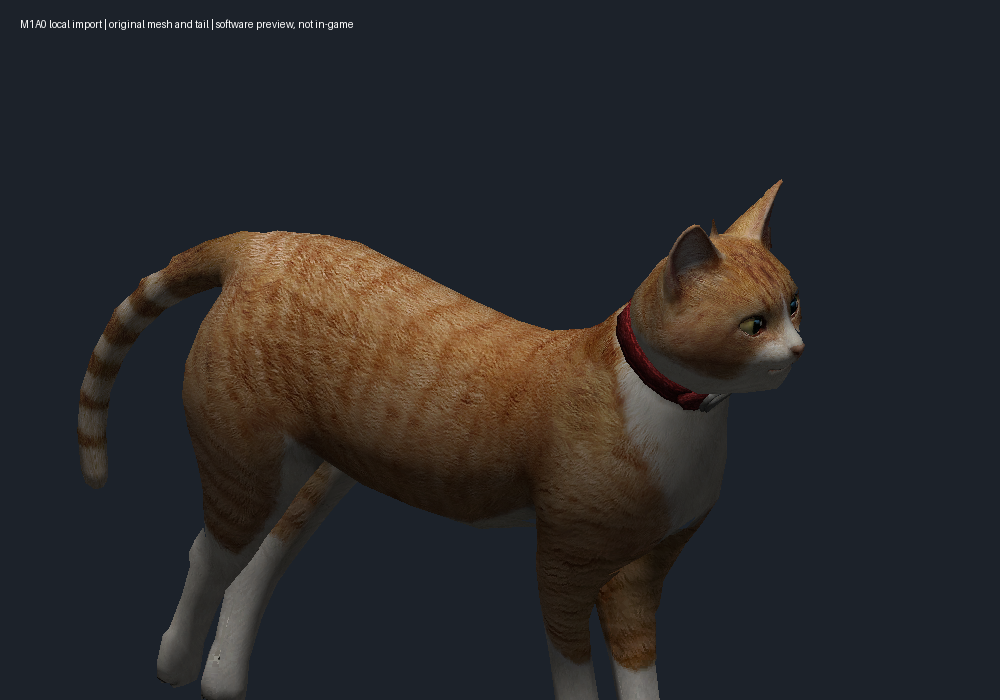

# Actual M1A0 ginger cat: local import

The original procedural gray cat was a placeholder. The user requested the
[M1A0 Cat Gun](https://steamcommunity.com/sharedfiles/filedetails/?id=827320827),
whose original model/textures/sounds are credited to Dragonfly GF Co., LTD and
Gameforge 4D GmbH (Special Force 2), with the Garry's Mod port by xdshot.
Those assets are not licensed under this repository's MIT license and are not
included as model, texture or audio files. Obtain the addon through your own Steam
installation. The importer does not execute Lua or download addon code.

```sh
cp catgun-m1a0.example.json catgun.local.json
.venv/bin/python catgun_cli.py import --config catgun.local.json \
  --addon /path/to/827320827/186170815312713193_legacy.bin
.venv/bin/python catgun_cli.py model --config catgun.local.json
.venv/bin/python catgun_cli.py build --config catgun.local.json
.venv/bin/python catgun_cli.py verify --config catgun.local.json
.venv/bin/python catgun_cli.py install --config catgun.local.json
.venv/bin/python catgun_cli.py restore --config catgun.local.json
```

Restore an existing cat or sight layer before installing another variant.
Build from the verified full halftone baseline and use a fresh output/backup
path for each variant. Source assets stay under ignored external-assets/.

Only the inspected GMAD v3, MDL v48, VVD v4, VTX v7 and DXT5 VTF 7.2 layouts are
supported. Archive sizes and CRCs, cross-file model checksums, hierarchy counts,
indices and texture format are checked. The reader uses layouts documented in
Valve's [studio.h](https://github.com/ValveSoftware/source-sdk-2013/blob/master/src/public/studio.h)
and [optimize.h](https://github.com/ValveSoftware/source-sdk-2013/blob/master/src/public/optimize.h).

The final local v5 variant keeps all **2,084 vertices and 3,128 triangles**,
including the original tail and rump. Source UV wrapping is preserved before
conversion to Unity UV coordinates. Geometry and ginger diffuse pixels are
verified after reopening the Unity bundles. The M1A0 remains a rigid cosmetic
child; its Source skeleton and animations are not imported into game logic.

An intermediate v4 tail-removal test removed part of the rump because skin
weights extended into the body. The user reported it from the armory. That
variant was restored, and v5 retains the complete source mesh. The initial
hipfire obstruction was reported on the earlier procedural placeholder tail;
it is not evidence that the original M1A0 tail needs changing.



The image is a software preview of third-party game content, not an in-game
acceptance test. Current v5 first-person placement, ADS and reload still need
visual testing. Earlier showcase screenshots show the procedural fallback.

The importer also extracts the addon WAVs for the independent
[cat audio module](cat-audio.md). It verifies every archive entry CRC before
writing the allowlisted files.
