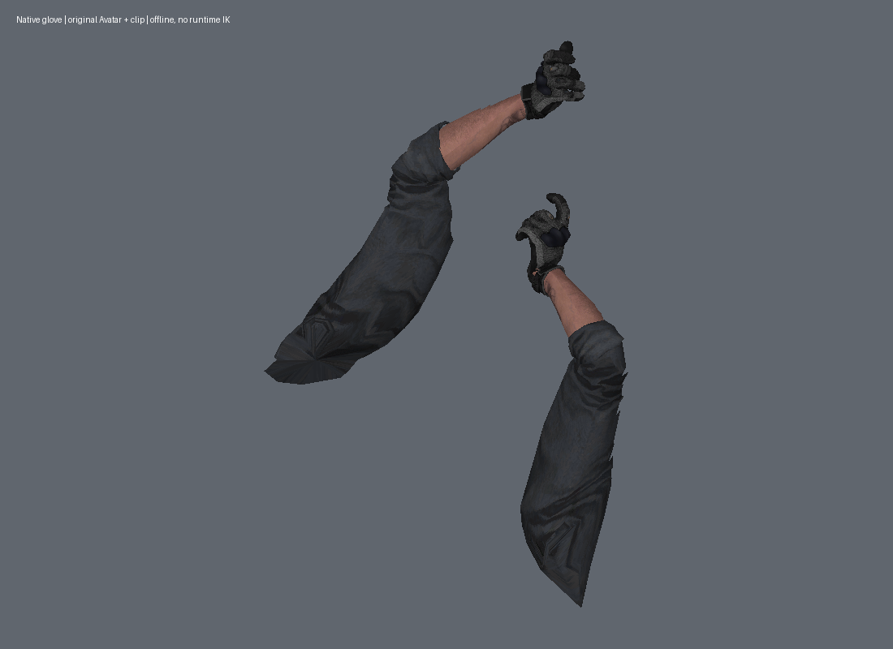
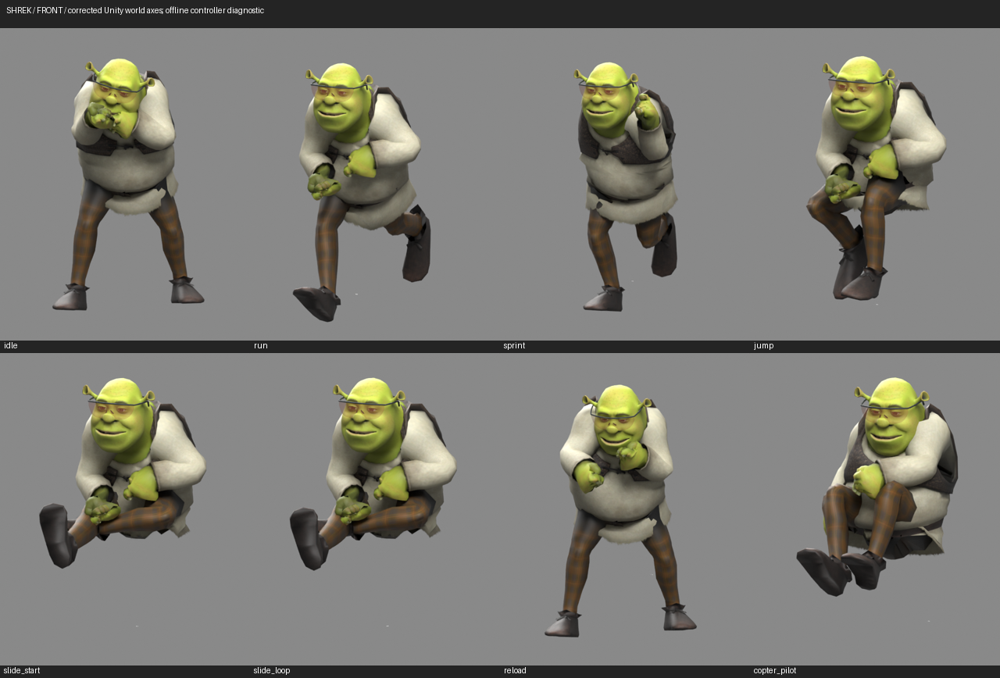
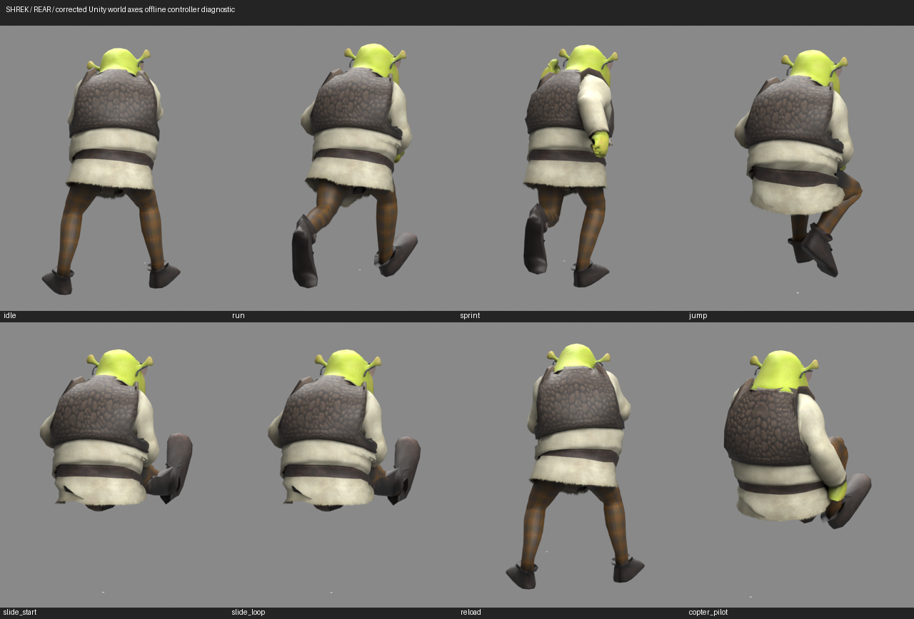

# Offline review of shipped operator clips

`operators.clip_review` samples the original game's generic transform curves
without launching the game or running any animation event, controller, script,
IK solver or network code. It is a diagnostic for authored model adaptation.
It does not change any installed asset or animation. First-person arms remain
the default; `--rig third_person` selects the reviewed world operator index.

Run from a private project workspace using its Python environment and verified
original backup bundle:

```sh
PYTHONPATH=public-repo .venv/bin/python -P -m operators.clip_review \
  --bundle /path/to/verified-original/src/first_person \
  --operator operator_0 --clip AK12_Arms_Idle --frame 0 \
  --output experiments/private-ak-idle-pose
```

`-P` prevents an older same-named package in the review workspace from
shadowing the checkout selected by `PYTHONPATH`.

The output must be fresh, outside the public source/package tree, and inside
the review workspace or an explicitly registered workspace-storage alias.
`pose.npz` contains renderer-local bone pose matrices and original inverse-bind
matrices; `review.json` records the original bundle hash, clip, frame, resolved
binding counts and limitations. These exports contain private native game data;
do not redistribute them or add them to an installer/repository.

Some arm clips live in a different original bundle. For the reviewed MP.V
idle and ADS clips, supply the original `src/src` bundle separately:

```sh
PYTHONPATH=public-repo .venv/bin/python -P -m operators.clip_review \
  --bundle /path/to/verified-original/src/first_person \
  --clip-bundle /path/to/verified-original/src/src \
  --operator operator_0 --clip Mp5_arms_ADS_Loop --frame 0 \
  --output experiments/private-mpv-ads-pose
```

The rig still comes from the verified first-person target. The reader selects
the clip only from the requested clip bundle and never silently falls back to
another source. Both original files are hashed before and after inspection;
output inside either source directory tree is rejected. Omit `--clip-bundle`
to retain the original same-bundle behavior.

World operator clips can be inspected through the same reader:

```sh
PYTHONPATH=public-repo .venv/bin/python -P -m operators.clip_review \
  --bundle /path/to/verified-original/src/thrid_person \
  --rig third_person --operator operator_30 --clip MP5_Run --frame 9 \
  --output experiments/private-dozer-run-pose
```

`thrid_person` is the shipped filename. The world rig is selected from
`config/operator-targets.json`, with the same original-renderer fingerprint
checks as the existing first-person path. The exported matrices stay in each
renderer's native coordinate system and units; they are not normalized into
an upright character pose. World exports additionally include each evaluated
renderer-to-world matrix and explicit space labels. Use that frame for posed
world previews; the original inverse bind matrices do not describe the posed
mesh's up axis. `review.json` records `rig_kind`. The default API
and CLI still select `first_person`, including when `--clip-bundle` is used.

### Review the actual serialized replacement

A freshly built world-operator stage can now be reviewed under an original
clip export. The reader selects the exact operator recorded in that export:

```sh
PYTHONPATH=public-repo .venv/bin/python -P -m operators.review \
  /path/to/private-verified-stage \
  experiments/private-scout-run-review \
  --pose clip --clip-pose experiments/private-scout-run-pose
```

Here `private-scout-run-pose` must be a fresh `operators.clip_review` export for
the staged Scout's operator identity, using the same immutable original bundle
as the stage. For the diagnostic roster below that was `operator_4`,
`MP5_Run`, frame 9; this is a private test assignment, not a new user default.
The clip option selects the reviewed LOD0 body renderer explicitly. The
output contains the staged model's serialized positions, UVs, materials
and weights, deformed by the original transform clip and converted with the
evaluated renderer frame. The pose arrays receive a recorded SHA-256 hash.
A changed/missing hash, different source, operator, renderer, bone order,
inverse bind matrix or coordinate-space description fails explicitly. There
is no fallback to another rig or a synthetic pose. Older pose exports without
hashes/world frames need to be regenerated.

The new option supports world operators only and requires a fresh private
output outside the public source/package tree. Run it from the private parent
workspace as shown above. The existing `bind` and `articulated` modes remain
available; default bind exports for all nine actual serialized TF2 models
retained byte-identical raw values, dtypes and shapes in 72 arrays, with exact
metadata and material PNGs. The CLI does not install a model, change an
assignment, invoke animation events, or run any game code.

The current-source TF2 build and 36-view review are documented in
[the serialized world-model review](world-serialized-clip-review.md), with
[verification details](world-serialized-clip-review-verification.json).

The reader supports the reviewed nonlegacy, uncompressed generic clip layout:
streamed cubic channels, dense samples at their exact sample frames, constant
channels, transform position/quaternion/Euler/scale bindings, and unique CRC32
path resolution within the selected native prefab. Reviewed Transform Euler
bindings with custom type 0 use XYZ order (`Rz @ Ry @ Rx` for column vectors);
the separately reviewed custom-type-5 Euler bindings use ZYX (`Rx @ Ry @ Rz`).
The world samples contain both orders in one clip, so order is selected per
binding. These differ from the ZXY order of the usual `Quaternion.Euler` API;
that API's convention must not be substituted for the clip format. Custom
type 5 is accepted only for the reviewed Euler attribute, not other transform
attributes. Missing or ambiguous hashes,
unsupported/discrete/object bindings, malformed channel lengths and
intermediate dense-frame times fail explicitly. Original renderer hashes are
checked against the project's reviewed target index for the requested rig.

Seven known Animator root channels are consumed and reported, not applied as
runtime root motion. Event counts are reported without invoking any event.
Actual runtime animation blending, procedural viewmodel placement, IK, camera
FOV and material/lighting behavior remain outside this sampler. An offline
render of sampled geometry is not an in-game screenshot or animation acceptance.

The original first-person bundle contains 1,520 clips. An initial-frame sweep
sampled 1,490 on the Ranger hierarchy and explicitly rejected 30 unresolved or
unsupported cases. This checks only one frame per clip, not full animations.
The initial AK12 idle
inspection resolved all 237 transform bindings on the native Ranger hierarchy;
seven separate Animator root channels were reported. CPU comparisons using
idle, ADS and a reload frame showed palm/finger stretching in the private
hand-control-to-wrist-driver remap. The candidate was kept out of production.
The initial implementation also separated hands on the **unmodified original
native glove control**. That discrepancy was subsequently traced to its wrong
Euler order and corrected as described below. A fresh bounded native range comparison
subsequently confirmed palm stretching in that direct-remap candidate, so it
remains rejected; correcting the diagnostic does not overturn that native
rejection. The earlier 928 numerical fits did not establish visual
quality. A separate nearest-native-hand-weight experiment also remains private
and unaccepted. Installed models and their original animation assets are
unchanged.

## Native Avatar comparison and Euler correction

The original first-person clips were loaded as data through Unity's standard
AssetBundle API into a private Editor project. An owned transform-only hierarchy
and built-in Animator/AnimationClipPlayable evaluated the original
`Hands_SkinnedAvatar`. No game MonoBehaviour, animation event, game controller,
network code or runtime IK was executed. Importing standalone cooked clips
through AssetDatabase and calling `SampleAnimation` produced zero motion and
were explicitly excluded from the comparison.

Six clips were sampled at 0, 0.5 and 1 seconds: AK12 idle, ADS and reload;
Kar98k idle and reload; and Dual1911 ADS. The corrected public sampler matched
the Editor across 36 renderer poses and 2,880 bone matrices. Maximum bone
position error was 0.000000762 m; maximum matrix-element error was
0.000001794. The former ZXY conversion did not match mixed-axis rotations.
An independent, entirely owned mixed-axis `quaternion.EulerXYZ` reference is
included in the regression test; no game clips or pose matrices are published.
[Counts, hashes and limitations](native-clip-euler-verification.json) accompany
the comparison.



Both corrected idle and ADS control renders have connected native wrists in
the inspected view. Fishguy's current authored arms still show a sharp wrist
transition under the same isolated poses. These renders use geometric normals
and a studio camera; they are offline diagnostic renders, **not native game
screenshots**. This establishes a useful isolated-clip control, not full
animation, grip, skinning-quality, camera or runtime-layer acceptance.

The authoring Editor was 6000.6.5f1; the game is 6000.3.19f1. The first private
Editor later crashed with code 139; the second produced the extended corpus
and subsequently terminated with code 143. Neither run establishes long-session
Editor stability. These terminal results do not alter the recorded numerical
comparison or justify installing a rejected wrist candidate. The production
model fitter, installer and installed game were unchanged by this correction.

The existing `operators.native_weights.read` decoder must be used when reading
compressed native glove skin. The project's checked five-bit reader already
handles the implicit fourth influence; the UnityPy fallback in the inspected
version can produce negative fourth weights. No third-party package or game
binary is patched for this diagnostic.

## MP.V cross-bundle comparison, November 7

Read-only inspection found 52 MP5-named arm clips in the original `src/src`
bundle. The original weapon bundle instead contains weapon-only MP5 clips.
The `ArmsMP5Weapon_Animator` controller points to `Mp5_Arms_Idle1` and
`Mp5_arms_ADS_Loop` in its base and ADS layers. These are static asset
relationships; they do not establish the runtime active state or blending.

The public sampler was compared with a fresh data-only native Avatar
evaluation of five MP5 arm clips at exact dense frames 0, 15 and 30: idle,
ADS, reload, empty reload and ADS reload. An AK12 idle sample retained the
same-bundle control. Across both original renderer rigs this compared 2,560
bone matrices, including 2,400 MP5 matrices. Maximum bone-position error was
0.000002289 m and maximum matrix-element error was 0.000002715. Both source
hashes stayed unchanged. The private Editor exited gracefully after the run.

The Editor version was 6000.6.5f1; the game is 6000.3.19f1. Only isolated
clips on an owned transform hierarchy were evaluated. Game scripts, animation
events, controller layers, IK and root motion were disabled or not executed.
Native matrices and hierarchy data remain private. This comparison validates
the sampler for these inputs; it does not accept Fishguy's model or reproduce
the full runtime grip. [Counts, hashes and per-clip errors](mpv-clip-review-verification.json)
record the scope. Eight focused regression tests pass, including a source-tree
output guard tested with owned sentinel files.

## World operator comparison, November 7

The reader now supports the reviewed third-person target index as an explicit
option. Seven original clips were evaluated on the original Dozer hierarchy:
`MP5_Idle`, `MP5_Run`, `MP5_Jump`, `MP5_Slide_Start`, `MP5_Slide_Loop`,
`MP5_Reload` and `Lobby_MP5_Idle`. Each was sampled at its beginning, a middle
dense frame and a frame inside its end. This compares 21 isolated poses across
all three 83-bone LOD rigs: 63 renderer poses and 5,229 bone matrices. Maximum
bone-position error against the native evaluator was 0.000000564 m; maximum
matrix-element error was 0.000005121. No tolerance was relaxed.

These clips exposed mixed Euler orders in one hierarchy. Custom-type-0 Euler
bindings retained XYZ; the eight custom-type-5 Euler bindings per reviewed
clip required ZYX. The separately generated owned `EulerZYX` fixture matches
within 0.000000072 per matrix element. Native pose matrices and hierarchy data
remain private; the regression fixture contains only owned angles and their
independent Unity.Mathematics result.

The actual world CLI exported all three Dozer rigs and matched the native
reference within 0.000004329 per matrix element for `MP5_Run` frame 9. A fresh
default first-person AK12 export retained byte-identical values in all four
NPZ arrays compared with the previous same-bundle control. The source suite
passes 191 tests, including one existing data-dependent skip. The focused
reader suite has 11 passing tests. [The verification record](world-clip-review-verification.json)
includes per-clip numerical errors and limitations.

The cooked original Dozer Animator has a null Avatar pointer. Explicitly
assigning the original `SOLDIERAvatar` in a separate private control changed
none of the 21 sampled poses. This does not establish how the live game assigns
its Avatar. Both private Editor runs exited gracefully. The authoring Editor
was 6000.6.5f1; the game is 6000.3.19f1.

The initial studio images of the original Dozer and installed Shrek both
appeared to tilt backward. A later renderer-frame control traced that shared
appearance to an error in the preview coordinate conversion, described below.
It was not corrected by rotating replacement geometry. Numerical agreement
with the evaluator does not reproduce the runtime controller's complete pose.

### Separate original-controller control

A further private evaluation loaded the original seven-layer
`ThirdPersonAnimatorMP5`, after confirming it has no StateMachineBehaviour
references or IK-pass layers. Eight explicitly chosen diagnostic scenarios
covered idle, run, sprint, jump, slide start/loop, reload and its seated
`Copter_Pilot` state. The resulting state hashes, layer weights and original
clip contributions were recorded. In the idle case, for example, the leg layer
uses `MP5_Idle` while the body layer uses `MP5_Rotation_Front`; the isolated idle
clip alone does not supply that combination.

This control evaluates original controller blending on a transform-only
hierarchy. It loads no game scripts or prefab components, disables events and
root motion, and executes no runtime IK. Chosen parameters and forced state
times are diagnostic inputs, not measurements of live game state. Its output
is separate from the isolated-clip corpus; it is not a claim that the public
sampler implements controller evaluation.

Front and rear renders of all eight scenarios were inspected, alongside an
unchanged Dozer run control. Their initial orientation was misleading because
the preview used the bind-mesh axes for evaluated renderer coordinates. The
corrected views below replace that orientation evidence. Shrek's rear vest and
tunic surfaces are present and textured. Tunic/leg and sleeve/hand
intersections remain unresolved quality findings, not accepted full animation
behavior. The glasses retain only Head_M influences; their maximum
head-local drift across the 21 isolated samples and eight controller scenarios
was below 0.000000003 m. That verifies rigid attachment, not face fit in every
scene, shader sorting or helicopter visibility.

`HelicopterIdle` in the original `src/src` bundle is a legacy vehicle clip,
referenced by six helicopter Animation components. It is not the operator's
helicopter-introduction animation. Likewise, a seated `Copter_Pilot` control
does not validate the Warzone introduction scene. Neither experiment changes
the production fitter, installed meshes, animation assets, operator choices or
game profile.

### Evaluated pose coordinates: correction

The original Dozer mesh's inverse bind pose is Z-up, while its actual transform
hierarchy and evaluated world animation are Y-up. The old studio export used
`native_frame(inverse_bind)` after skinning. For this mesh that returned an
identity matrix, which mislabeled the Y-up posed vertices as Z-up. Both the
original Dozer and Shrek consequently appeared to fall backward in Blender.
That was a diagnostic conversion error, not a game model orientation fix.

A fresh private Editor control captured the renderer's actual local-to-world
matrix for the rest pose and all eight controller scenarios. All 27 bone-matrix
sets remained exactly identical to the earlier native capture. The corrected
preview applies the evaluated renderer frame, followed by one explicit Unity
world Y-up to studio Z-up conversion. Normals use the inverse transpose;
posed bone frames follow the same coordinate conversion. Neither animation
channels nor replacement bind geometry are changed.

`operators.pose_space` provides that explicit conversion for private review.
It takes evaluated renderer coordinates and posed inverse bone frames; do not
pass a bind-pose axis guess. The world clip exporter now saves evaluated
renderer frames, while retaining all six prior world pose/bind arrays and all
four first-person arrays byte-for-byte. Three owned tests cover axes,
translation, nonuniform scale, unit conversion, normal direction, coordinate
round trips and invalid inputs. The current source suite passes 198 tests:
197 passed and one existing data-dependent skip.

Corrected front/rear views of all eight Shrek scenarios and the original Dozer
run control were rendered and inspected. Both run controls are upright.
Shrek's vest/back remains present; sleeve/hand and lower-tunic intersections
still require fitting work, especially in bent-leg poses. These are offline
studio renders with diagnostic controller parameters, no weapon mesh, no game
scripts and no runtime IK. They do not validate actual grip, locomotion, live
materials, the helicopter introduction or game performance. The private Editor
closed gracefully. [Frame, export and render evidence](world-pose-space-verification.json)
records the scope. This source-only diagnostic addition is newer than the
v0.1.12 portable packages; their production model builders are unaffected.

Two private lower-tunic weight experiments blended 35% or 65% hip influence
into 287 vertices while retaining rest geometry, topology, UVs, accessories,
all other skin weights and native animation data. They removed some strict
crossing pairs but introduced 273 and 370 new pairs, respectively, across the
eight diagnostic poses. Their four-influence truncation also discarded up to
5.4% mass at affected vertices. Both candidates are rejected and uninstalled;
the lower overall crossing total is not acceptance. The checker excludes
coplanar and boundary-only contact and is not a full collision proof.
[Rejected-experiment record](shrek-tunic-experiment-verification.json) preserves
the result for subsequent fitting work.

Three further geometry-only candidates expanded the existing lower tunic by
6%, 12% or 18% with smooth height/side falloffs, moving at most about 1.4–4.1 cm
in the rest mesh. All skin weights, topology, UVs, materials, accessories and
native animation data stayed exact. All eight controller poses were measured;
front/rear comparisons of idle, slide, reload and seated poses were inspected
for the strongest candidate. Slide crossings decreased, but run/reload and
other poses regressed, and visible hem tears remained. All three are rejected
and uninstalled. This is not a production clothing fix.
[Geometry-experiment details](shrek-tunic-volume-verification.json) record the
scope; [front](screenshots/shrek-tunic-volume-front-nov7.png) and
[rear](screenshots/shrek-tunic-volume-rear-nov7.png) comparisons show current
above candidate.






The Shrek mesh is HarrisonHag1's CC BY 4.0 source, credited in
[operator attribution](../assets/operator-sources/ATTRIBUTION.md); the glasses
are MWC-authored. These images show the current installed model with corrected
preview axes, not a newly installed deformation fix. Unity documents
[local-to-world conversion](https://docs.unity.com/en-us/engine/6000.6/script-reference/unityengine/transform/localtoworldmatrix)
and [world up](https://docs.unity.com/6000.3/Documentation/ScriptReference/Vector3-up.html)
separately from mesh bind poses.

### Preview loading cost

The Blender diagnostic renderer now loads each NPZ array once before its mesh
corner loops. Previously each UV and normal lookup decompressed the entire
array again. A 32,373-vertex original-mesh control retained exactly identical
RGBA pixels with the same camera, materials, normals, geometry and render
settings. Approximate launch-log-to-image timings were 356 seconds before and
10 seconds after in this local control. This is a preview-generation fix, not
a game-FPS change or a general benchmark. PNG metadata may differ between
output paths. [Pixel comparison and timing scope](preview-render-cache-verification.json)
record the check.

Format and convention references:

- [AssetStudio's original AnimationClip layout](https://github.com/Perfare/AssetStudio/blob/master/AssetStudio/Classes/AnimationClip.cs)
- [AssetStudio's generic binding and path resolution](https://github.com/Perfare/AssetStudio/blob/master/AssetStudioUtility/ModelConverter.cs)
- [Unity 6 Quaternion.Euler](https://docs.unity.com/en-us/engine/6000.3/script-reference/unityengine/quaternion/euler)
- [AssetStudio's five-bit skin format](https://github.com/Perfare/AssetStudio/blob/master/AssetStudio/Classes/Mesh.cs)

The sampler is an independent, scoped data reader. It does not bundle native
clips, skeletons, meshes or any external tooling.
