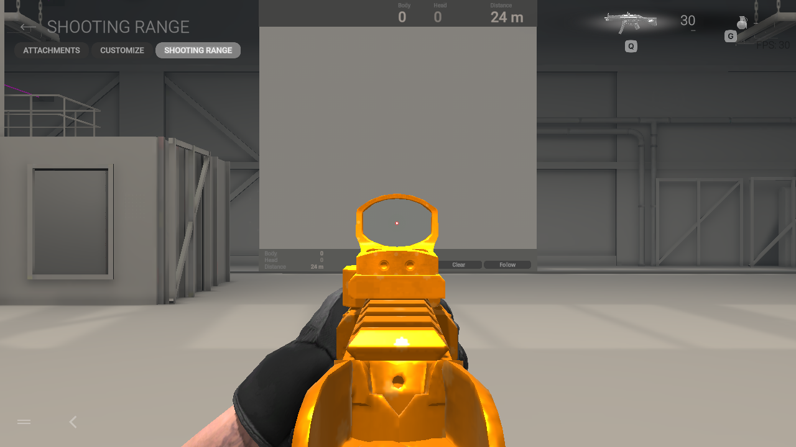
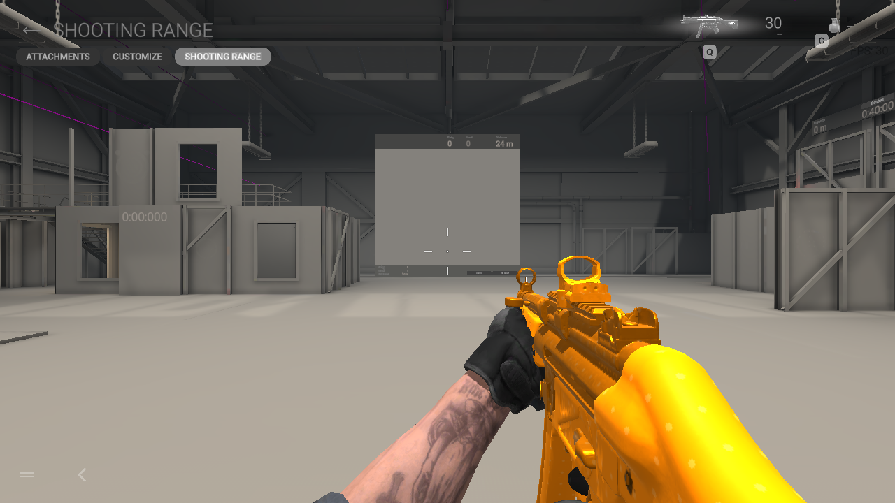

# Native stationary camera-pose controls

The private Linux asset-test harness now supports a single bounded ADS pose
request in the official empty shooting range. It sends one right-button
press/capture/release sequence, retains the original camera and weapon scripts,
and runs only in a copied profile under the existing read-only, network-isolated
headless game. No firing, movement, aiming assistance or repeated combat loop
was added. This diagnostic is outside the distributed installer.

A native original-arm control confirms a clear sight picture while aimed and a
return to hipfire after the second explicit pose request. The copied guest
profile uses toggle aim: releasing the physical button alone leaves the camera
aimed. Capture review, rather than a button-release assumption, establishes the
observed pose. Invalid/unready pose requests fail before dispatch, and menu
click/drag requests are blocked once the verified range route completes.

[The evidence index](native-pose-control-verification.json) records capture hashes,
the original-arm baseline scope and process results. The native game exited 0;
Gamescope teardown returned 139. The host profile retained its hashes. These
1280×720, 30-FPS-capped controls establish the pose-inspection path, not custom
model animation acceptance or performance. Custom models require their own
reviewed captures in the same pose.
