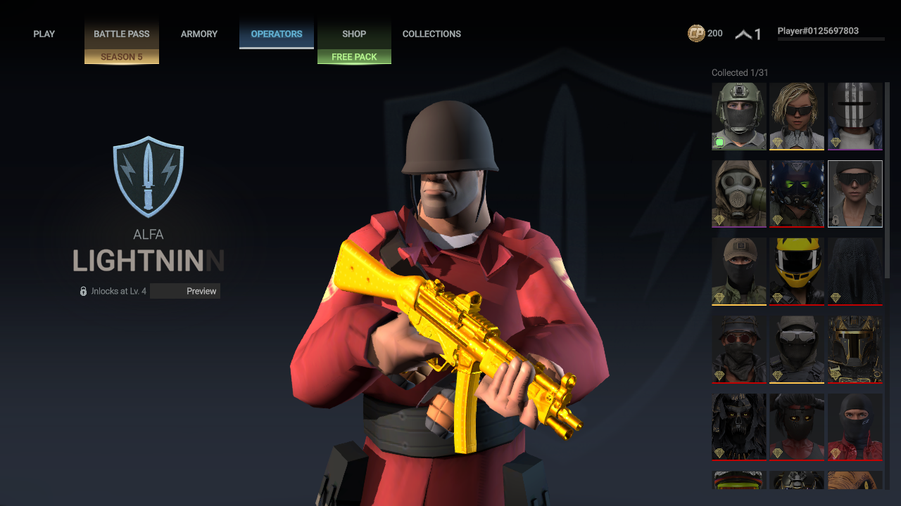
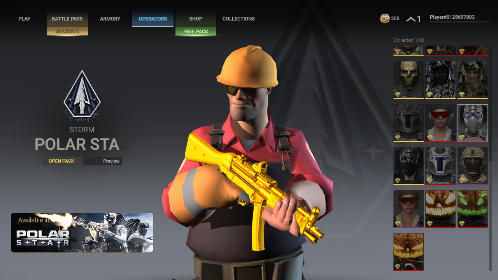
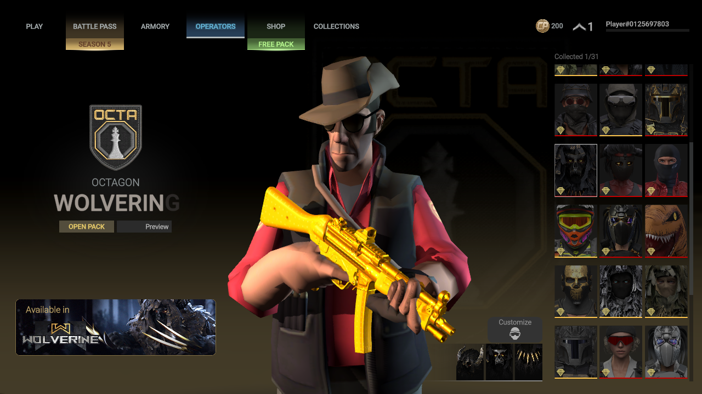
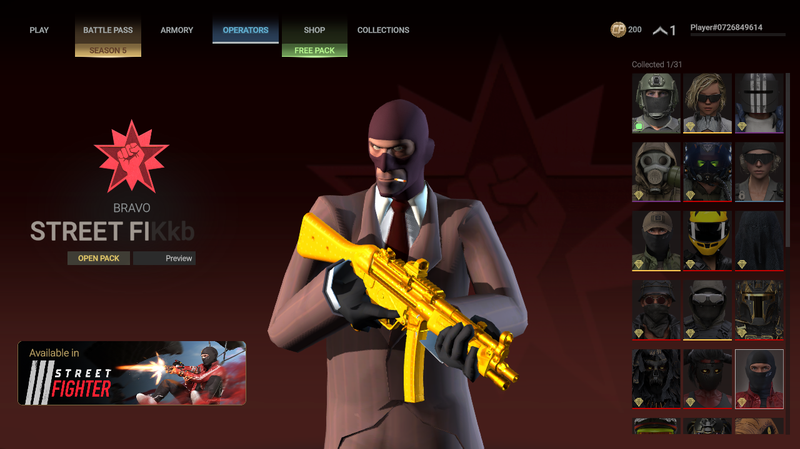
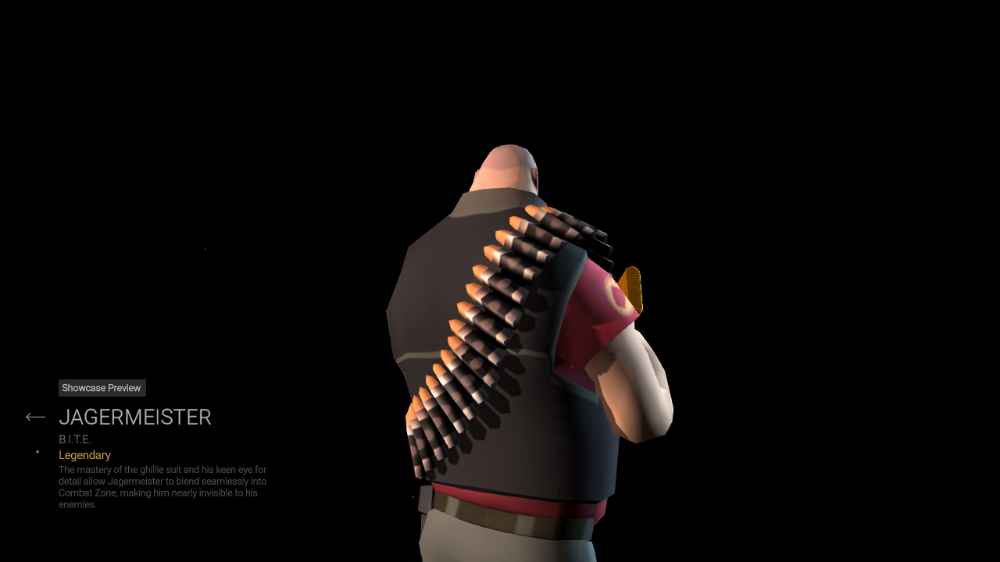
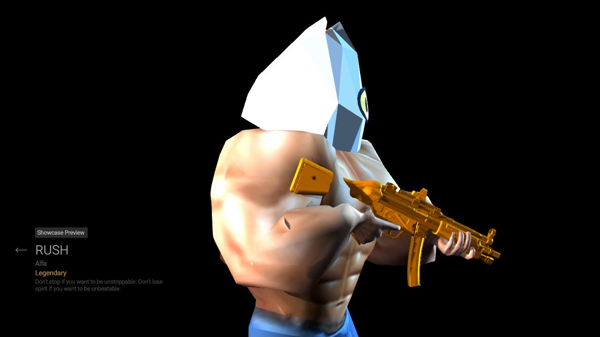

# Native operator review — November 3, 2026

The installed user selection remains **Ranger → magenta Stim pilot** and
**Dozer → Shrek**. Fishguy is optional. The stretched Fishguy seal is intentional.

The [current gallery](screenshots/README.md) includes real native game captures.
The Linux game ran at 1280×720 through a private headless NVIDIA/Vulkan display,
with a copied profile, read-only game mounts and a separate network namespace.
Normal menu selection, showcase and rotation controls were used. No match,
purchase, reward claim, movement or shooting was performed. The original
profile stayed byte-identical. The game exited normally; Gamescope returned
139 during shutdown. These are limited appearance checks, not full animation,
gameplay, general stability or 4K performance acceptance.

## Private model roster

A separate staged bundle assigned source-color models to existing preview
slots solely inside the test namespace. It was **never installed**, and never
saved to the user's operator choices. Source colors were deliberate for
inspecting character details; the manager's independent magenta options and
existing defaults stay unchanged.

| Private preview slot | Model seen | Finding |
|---|---|---|
| Rush | Fishguy | Recognizable low-poly sardine head and muscular body. Rear geometry is present and skin-colored. A later anatomical palm fit smooths the wrist transition; full grip and animation acceptance remain pending. |
| Alisa Lynx | Minecraft Steve | Recognizable texture, block head and limbs render; proportions/grip need further review. |
| Skull Face | TF2 Scout | Renders with cap/headset and original outfit; full animation/grip acceptance pending. |
| Shadow Rider | TF2 Medic | Renders with original coat, glasses and gloves; full animation/grip acceptance pending. |
| Lightning | TF2 Soldier | Helmet originally followed the chest and covered the face; head attachment corrected and native holding pose rechecked. |
| Polar Star | TF2 Engineer | Hardhat originally followed the chest and covered the face; head attachment corrected and native holding pose rechecked. |
| Wolverine | TF2 Sniper | Hat originally followed the chest and covered the face; head attachment corrected and native holding pose rechecked. |

Mario, Pyro, Demoman, Heavy and Spy have now also rendered in normal native menus. Spy was assigned to the selectable Street Fighter slot in a later private test; the mode-specific Demon_DS_Game_Mode slot was left alone. No unlock or inventory changes were used.

## Material compatibility fix

The real roster build exposed external native material references on
Jagermeister and Street Fighter. Nighthawk's donor uses a different helmet/skin
shader. Authored replacement bodies now use a reviewed local character material
for these cases, preserving its native shader dependency and replacing its
texture bindings on a new copy. External PPtr numbers are never interpreted as
local material IDs. The selection and reason are recorded in the build manifest.
Original materials and unassigned operators are untouched. First-person arms
continue using their own native skin material interface.

A separate real-bundle build placed Fishguy on all 32 native targets to exercise
this path: geometry/UV/skin/reference checks passed, original renderer changes
stayed within mesh/material/bounds fields, and 34,223 other original objects
stayed byte-exact. This diagnostic bundle was not installed. It establishes
build coverage, not correct animation on every target.

## Release distinction and remaining work

The public **v0.1.1-preview** installers contain the earlier transparent Shrek
lens, Rush empty-LOD handling and optional local TF2 Medigun audio. Their uploaded
hashes were verified; Windows runtime/code/assets match the VM-tested package.

The world-material selection and TF2 headwear fixes described above are newer
source changes, not included in v0.1.1. That release can reject Jagermeister or
Street Fighter replacement builds, and its Soldier/Engineer/Sniper headwear can
misalign. Missing support fails before installation. Updated source includes
these fixes; check each newer release's source revision and validation notes.

The current suite runs 102 tests: 101 passed, one existing data-dependent skip.
Fishguy and other character hand deformation, remaining model previews, full
animations/helicopter scenes, first-person grip/ADS/reload, optional audio
playback and 4K performance remain open. Do not treat numeric fits or these menu
screenshots as completion of those checks.

## Further hierarchy correction and honest quality limits

The native review exposed stretched Spy cuffs, a cigarette attached to his chest,
and misplaced Heavy bandolier sections. Secondary TF2 bones now inherit their
reviewed anatomical ancestors: cuffs follow forearms, cigarettes/headwear follow
the head and coat tails follow the pelvis. Real central spine helpers stay in the
continuous torso fit. Torso props inherit that fitted body frame instead of
snapping to a different native spine position. Heavy's connected bandolier
sections share one chest frame so they retain their continuous diagonal.

These fixes passed private serialized bundle checks and the shown native holding
poses. A renewed numerical first-person matrix passed 812 fits across 14 models
and 29 unique prefabs. That does not prove real first-person grip or all animation
states. Other model comparisons retain identical normals, bone indices and skin
weights; Shrek/Mario positions differ by less than 0.000001 metres from the prior
fit because of float32 rounding. The installed bundles remain unchanged.

Fishguy now uses native palm width to fit hand volume separately from torso
scale. A mesh-edge displacement solve blends the fitted hand into only the
distal forearm; the upper arm, torso, head, source triangles, UVs and skin weights
stay unchanged. The native preview below shows the private Rush test alias,
not a changed default assignment. Front and rotated views have a smoother wrist
than the earlier pinched prototype. His back remains intact.

The integrated fit differs from this preview trial by at most 0.000008 native
centimetres in positions and 0.000013 in normal components, because it preserves
each duplicate source position rather than replacing it with a welded neighbor.
Weights and indices match exactly. Both world and first-person bundle builds
round-trip correctly; 34,569 and 144,988 other original objects respectively
stay byte-exact. The renewed first-person matrix passed all 812 fits. Fishguy's
first-person arm radius remains 0.60; hand radius is 1.0 because anatomical fitting
already matches palm width. A synthetic bent-arm render was reviewed, but actual
first-person grip, ADS, reload and full animation acceptance are still pending.
The source enables this fit only for Fishguy. Current installed game selections
and bundles remain unchanged. Mario renders with his authored head/glove
proportions, but the native menu camera crops his hat and his grip needs review.
The TF2 characters remain experimental for full animations, grip and helicopter
scenes even though all nine have now rendered.

The current source suite runs 102 tests: 101 passed, one existing data-dependent
skip. These hierarchy changes are newer than the published v0.1.1 binaries;
release notes identify the source included in subsequent installers. No character source is replaced
with primitive geometry, and no Valve model/audio binaries are published.
