# Gameplay captures

These frames were extracted from user-provided Combat Master recordings
dated November 2, 2026. They are cropped and resized; their colors were not
edited. The recordings themselves are not included.

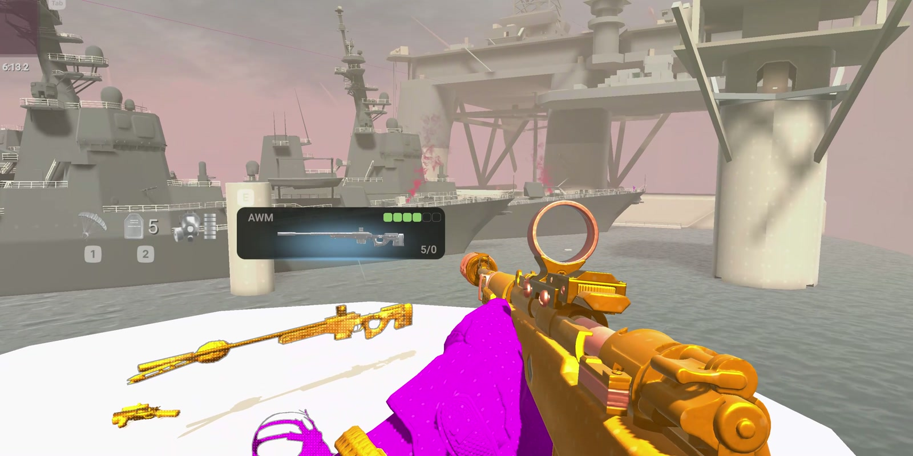

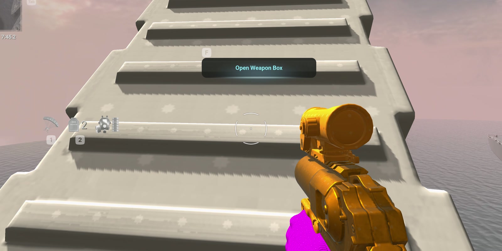

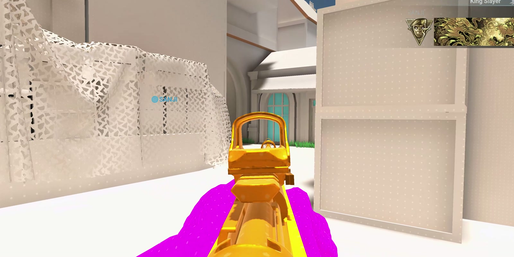

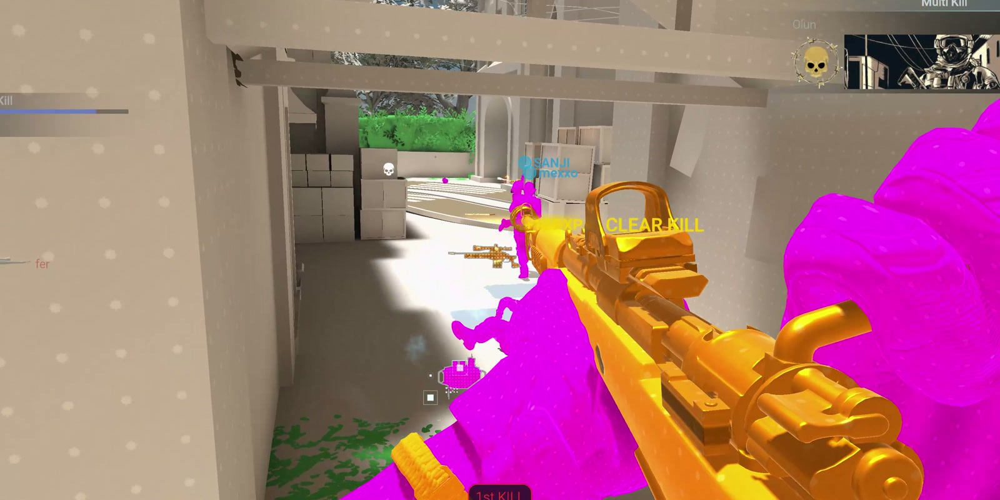

These show the retexture work. They are not controlled before/after
comparisons, do not establish performance, and do not show the Lynx cat
prototype. Frame timestamps and crop coordinates are recorded in
[provenance.json](provenance.json).

## Native offline Lynx preview

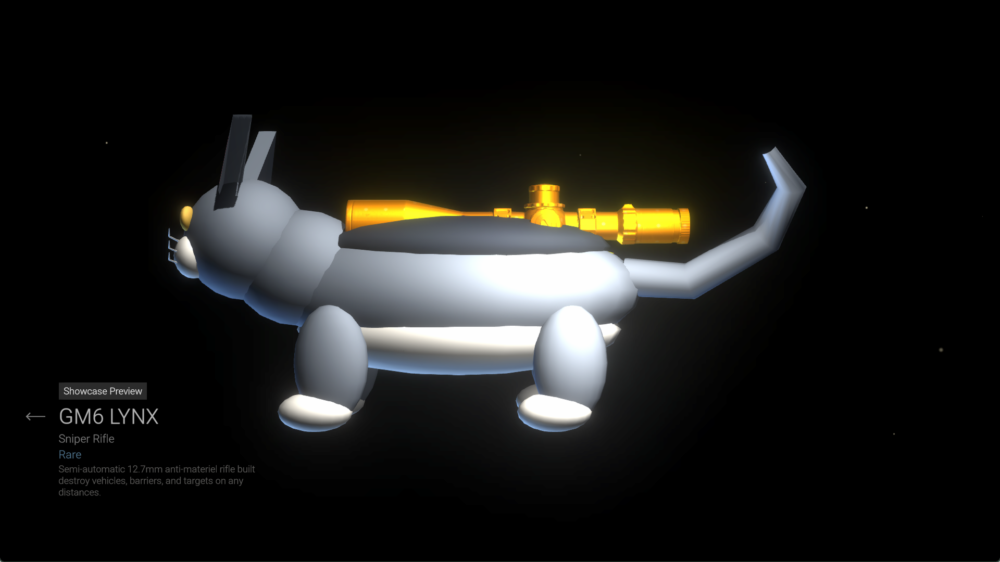

Captured by Codex on November 2, 2026, from a network-isolated native Linux
game process using the normal weapon showcase UI. This verifies preview
rendering, upright forward orientation, and receiver/magazine hiding. It does
not verify firing, reload, ADS, multiplayer behavior or performance. The game
window decoration was cropped; colors were not edited.

## M1A0 software preview

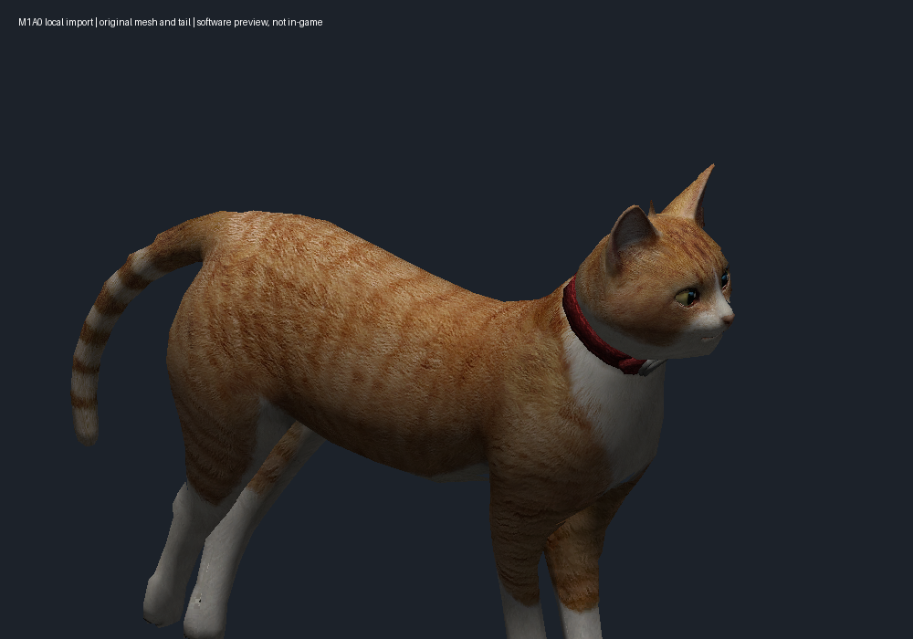

This preview uses the full locally imported M1A0 mesh and ginger diffuse,
including its original tail. It is not an in-game capture. Source assets and
credits are described in [the import guide](../m1a0-local-import.md).

## Current operator and installer runtime checks — November 3

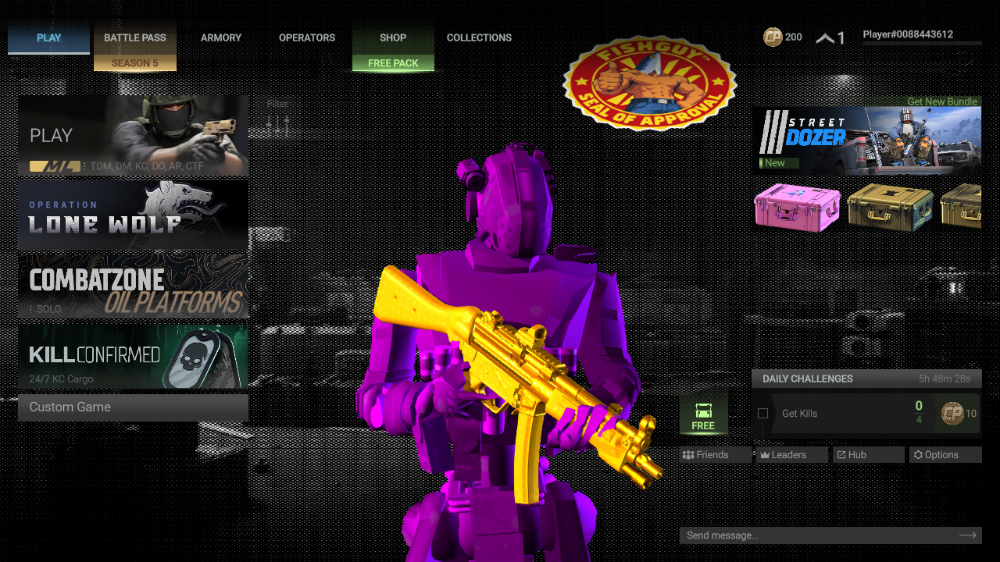

The background uses the original game scene with the existing halftone treatment.
The oval Fishguy seal is deliberately kept stretched at the user's request.

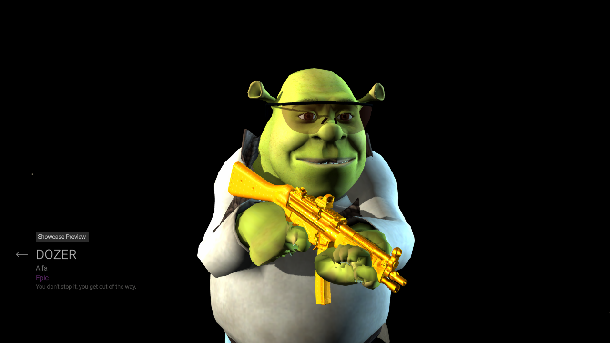

These are real native Linux game captures at 1280×720, using the installed
bundles mounted read-only, a copied profile, a separate headless NVIDIA/Vulkan
display, no host audio, and a network namespace with no external connectivity.
Only ordinary menu/showcase controls were used. No purchase, reward claim,
match, movement or shooting was performed. The original profile's hashes stayed
unchanged. Ranger/Dozer identity and visible lens transparency are confirmed;
helicopter scenes, full animations, first-person alignment and 4K performance
remain untested. The game exited normally; the private Gamescope compositor
returned 139 on shutdown, so this does not establish general runtime stability.

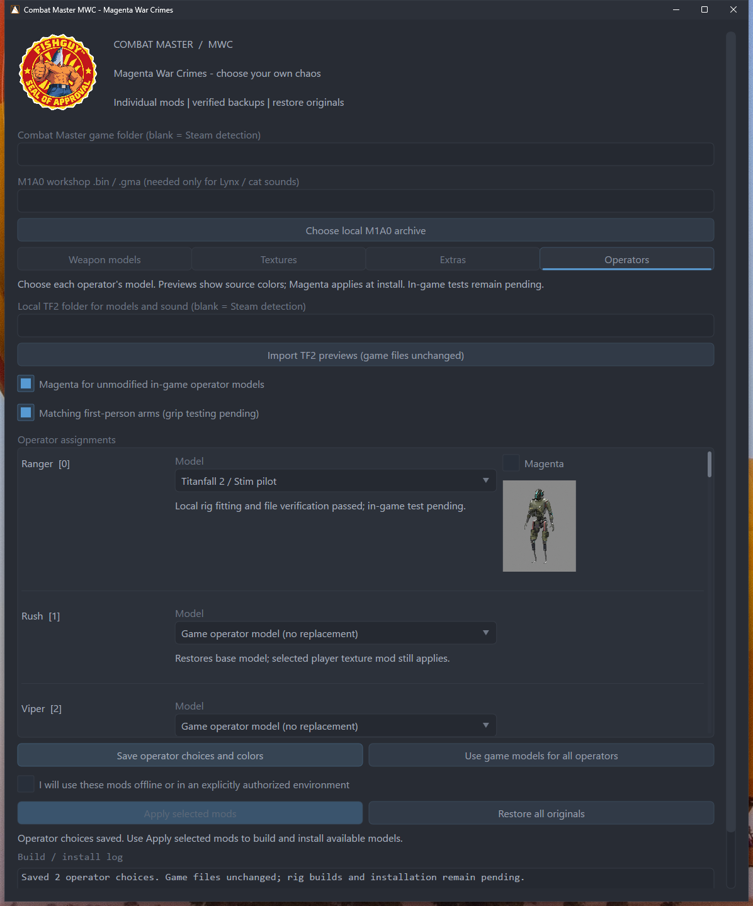

The current Windows package rendered in the user's Windows 11 VM and its actual
Save button preserved model choices, independent colors, the 19-mod catalog and
the optional Medigun audio selection. Packaged module/assets diagnostics and
synthetic FMOD PCM round-trips at 44,100 and 22,050 Hz passed without playback.
No Windows game installation was performed. The test files were removed, the
temporary share detached and the VM returned to its original powered-off state.

## Current weapon menu checks — November 3

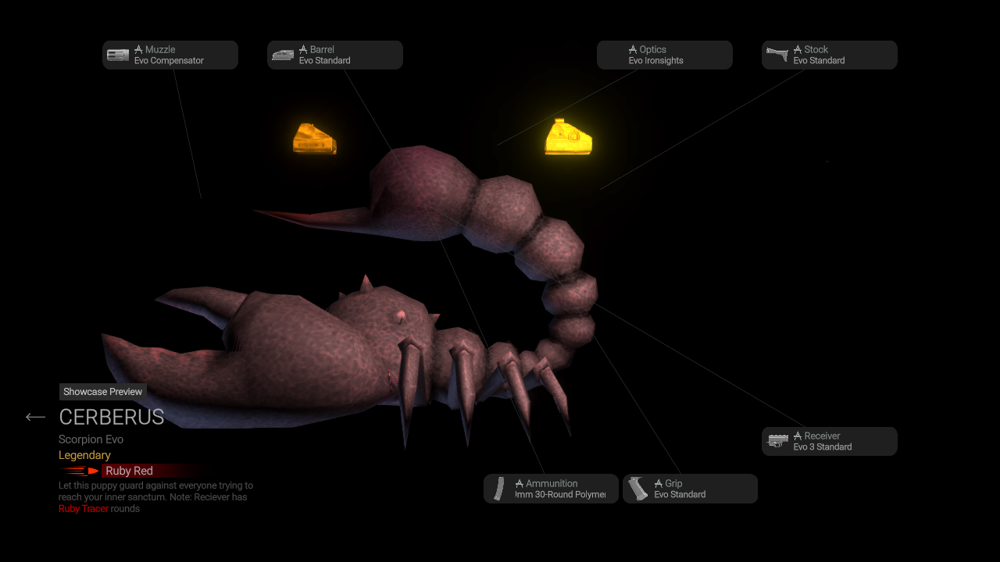

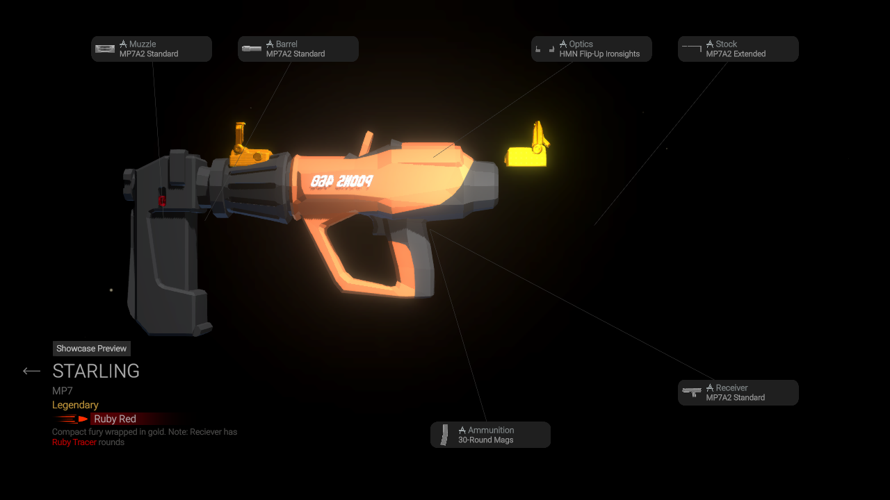

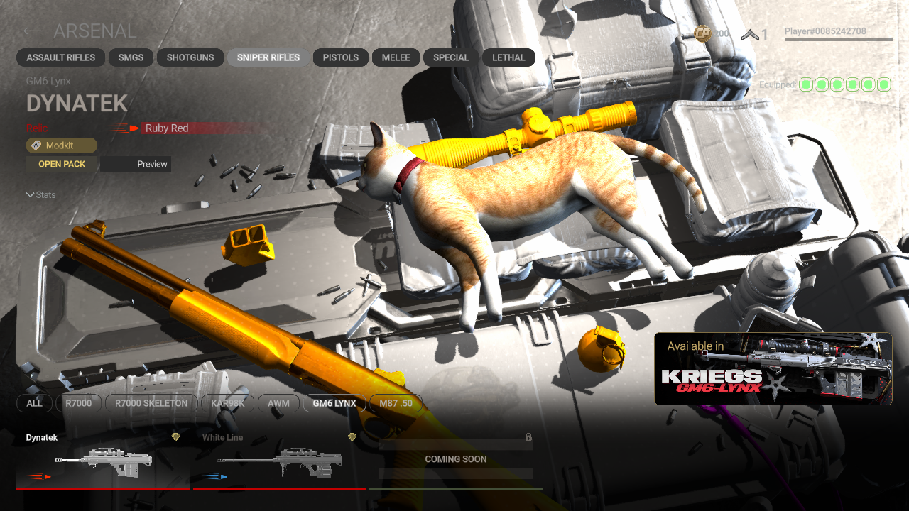

The same isolated native setup also rendered the fishing rod and red toaster.
These checks cover preview appearance only. The toaster's broad plain side
faces the showcase camera, hiding much of its detail. Native gold attachments
are intentionally separate from the replacement bodies. ADS, reloads, hipfire,
all attachment/LOD combinations, sound playback and performance remain
unchecked. The Minigun Kill Chains UI shows a static promotional image, so it
cannot verify the installed Medigun mesh. No match was entered.

For the private operator roster, confirmed Fishguy rear geometry, TF2 headwear corrections and remaining deformation problems, see [the native operator review](../operator-runtime-review.md). Those source-color test assignments were never installed as user defaults.

## Stationary native pilot arms — Parvis

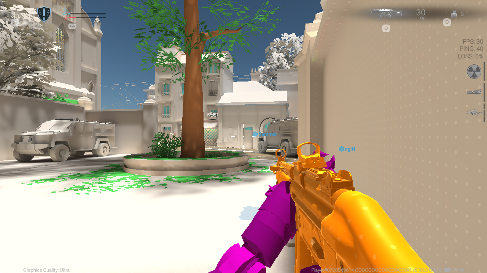

Captured November 3 at 1280×720 in the isolated private session, with the
installed visual bundles read-only and a copied guest profile. The game supplied
its ordinary bots. No movement or firing input was sent. This confirms visible
pilot arm replacement in the idle view; ADS, reload and 4K performance remain
unverified. The capped 30 FPS is a test-display limit, not a performance result.
See the [sky reference audit](../skybox-coverage.md) for the uncovered original
Parvis sky and the newer source fix.

## November 4 installed human pilot and sky check

These captures use the actual installed 17-mod stack with no staged asset
overrides, in a network-isolated native Linux session. Ranger uses the armored
human Grapple; Dozer remains Shrek and the female Pulse Blade is optional. The
pilot source is the user's local Titanfall 2 installation; no native model or
texture source is distributed in MWC.

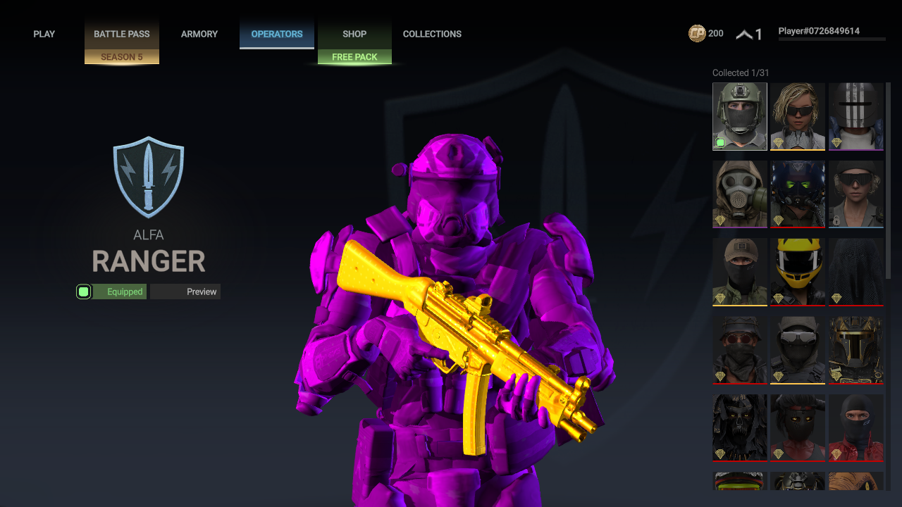

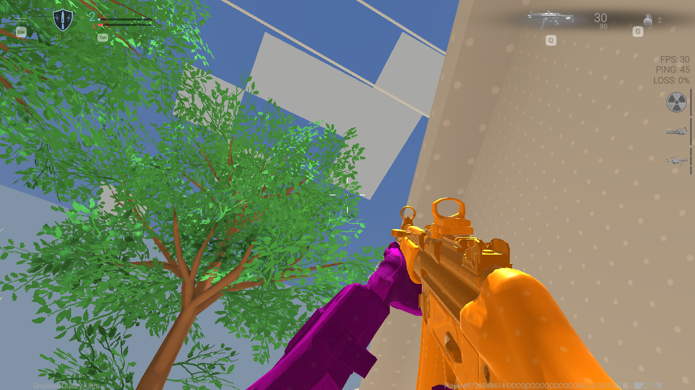

The stationary captures establish those visible features together. They do not
prove full movement, ADS/reload, helicopter appearance, audio playback or 4K
performance. The test used 1280x720 with a 30-FPS cap and sent no movement or
firing inputs. Source and test details: [native pilot workflow](../titanfall-native-import.md).
