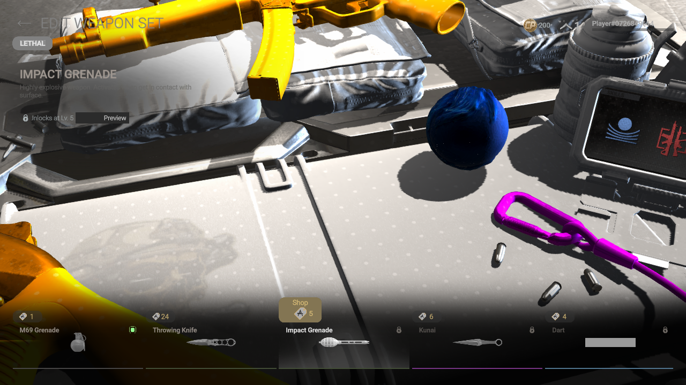
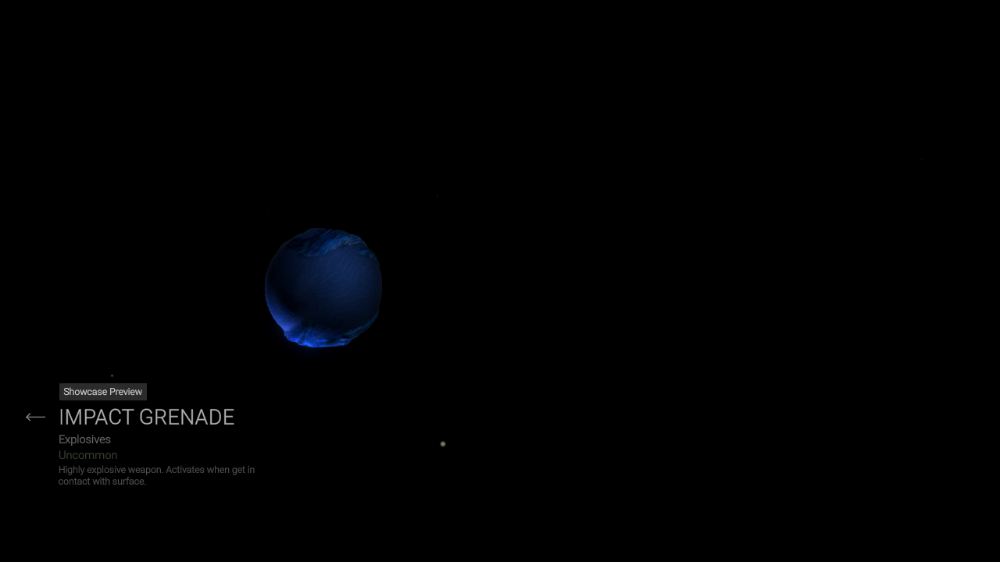

# Sonic impact grenade: native menu review, November 7

The current Sonic spin-ball mesh now has a limited native Linux appearance
check. A private offline session opened the ordinary Armory equipment catalogue,
selected **Impact Grenade**, and used its normal **Preview** button and drag
rotation. The copied level-1 profile still displayed **Unlocks at Lv. 5**.
No unlock, purchase, equip, reward claim, match, throwing or firing action was
performed.

The blue curled-quill texture and spin-ball silhouette are present. The source
is Swenzy's existing Sonic Ball Spin / Sonic Dash model, not an upright Sonic
character or newly generated placeholder. Attribution and source hashes remain
in [its provenance record](../assets/authored-weapons/sonic_impact/provenance.json).
The reviewed candidate matches the current public geometry in all three held
LODs and the thrown visual. This is a file-level coverage check, not proof that
all four visuals were observed in gameplay.

## Material finding and rejected control

A rotated showcase view produces a bright blue-white hotspot that hides some
surface detail. The source albedo has no corresponding white hotspot. This
appearance remains a quality issue; the preview is not full material acceptance.

The material uses the native UniversalSkinshader's declared `_IsWeapon`
property. A second private candidate changed only that value from 1 to 0.
All 25,770 other objects stayed byte-identical, as did every other material
field, the texture data and the mesh data. The bright hotspot persisted in a
rotated native showcase, so the candidate was **rejected**. No production
material recipe or installed bundle was changed. This result does not prove
which other shader input causes the hotspot; future experiments must test
that separately.

A third native control retained the original material properties and changed
only the alpha of Sonic's dedicated linear `Metallic` data texture, from
`(0,255,255,255)` to `(0,255,255,0)`. RGB, albedo, normal data and all 25,770
other objects remained byte-identical. A strong bright patch remained in its
rotated showcase. This is not an accepted production fix or proof of the
shader's packed-channel interpretation. It remains a private diagnostic;
the shipped shader inputs need further investigation.

## Scope and reversibility

All three sessions used read-only game mounts, a single private weapon-bundle
override, a copied profile, a private NVIDIA/Vulkan 1280×720 output and no host
display or audio. Network access was isolated. All three native game processes
exited with code 0; Gamescope returned 139 during teardown. The host profile
stayed byte-identical. This does not establish general stability or FPS:
the private output was capped at 30 FPS.

The Sonic candidate was never installed into the normal game. Closing the
private session removes its asset override; installed selections, operator
assignments, Lynx/audio and restoration backups remain unchanged. The installer
source now describes the equipment-menu check without claiming held/thrown
acceptance. Published v0.1.11 packages retain their earlier status text.

Still open: first-person grip and held placement, actual thrown appearance,
animation/LOD behavior, material quality across lighting, optional Sonic
sounds, native Windows and 4K/performance checks. Original collision, physics,
damage and other nonvisual assets remain covered by the existing serialized
visual whitelist; those file checks are not a gameplay test.

[Verification details and screenshot hashes](sonic-impact-native-verification.json)
record the exact scope.
