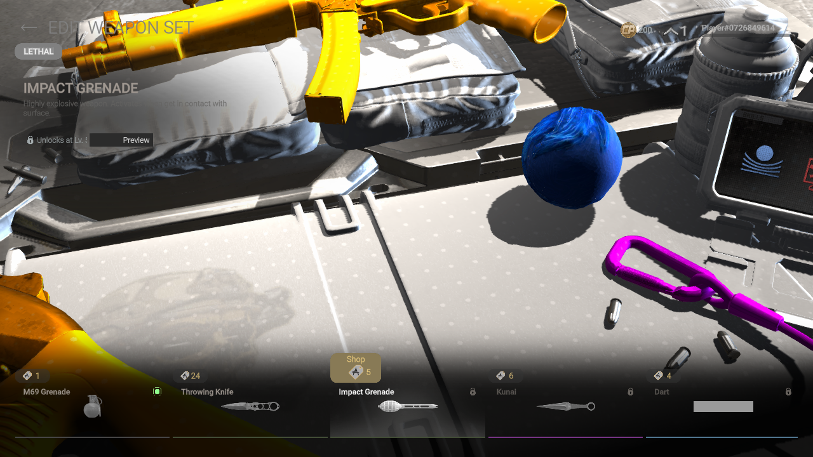
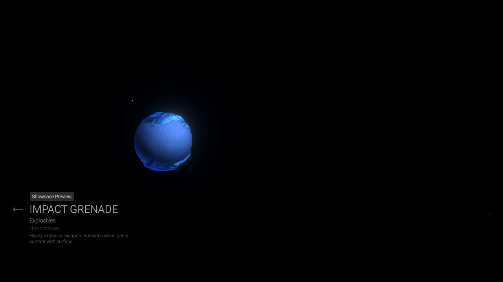
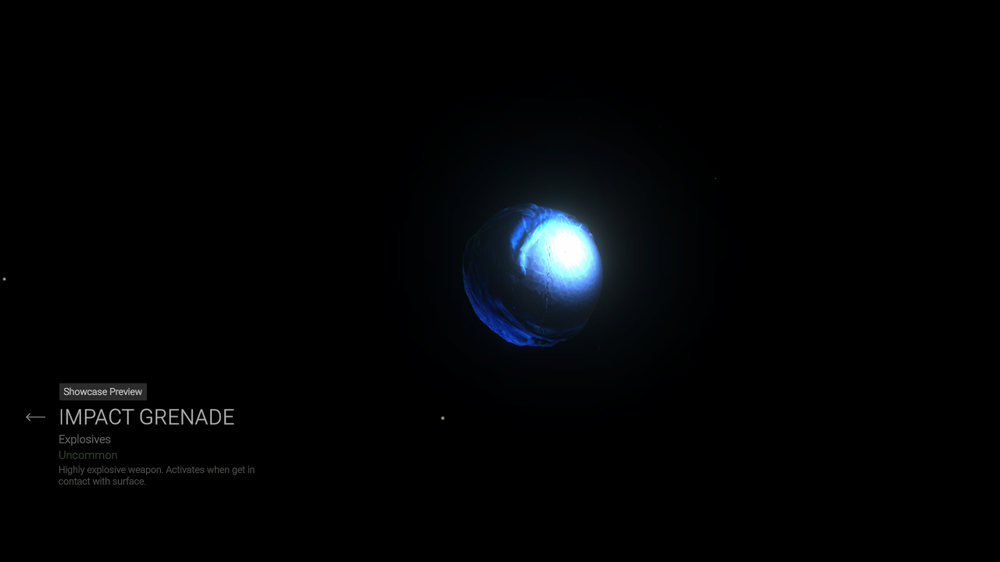
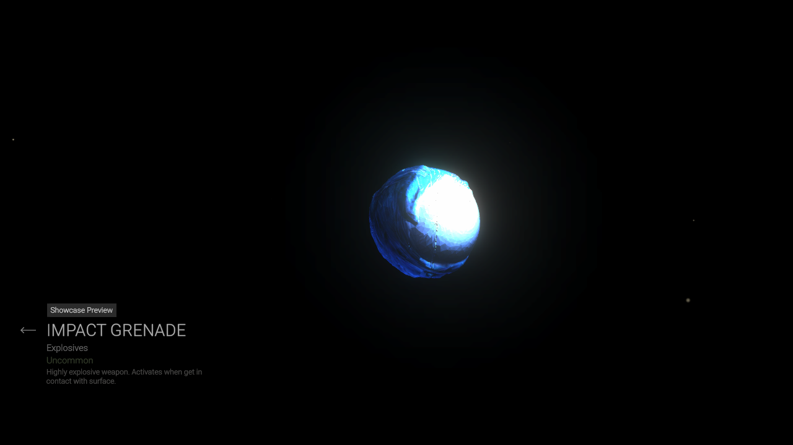

# Sonic impact grenade: native menu review, November 7

The current Sonic spin-ball mesh now has a limited native Linux appearance
check. A private offline session opened the ordinary Armory equipment catalogue,
selected **Impact Grenade**, and used its normal **Preview** button and drag
rotation. The copied level-1 profile still displayed **Unlocks at Lv. 5**.
No unlock, purchase, equip, reward claim, match, throwing or firing action was
performed.

The blue curled-quill texture and spin-ball silhouette are present. The source
is Swenzy's existing Sonic Ball Spin / Sonic Dash model, not an upright Sonic
character or newly generated placeholder. Attribution and source hashes remain
in [its provenance record](../assets/authored-weapons/sonic_impact/provenance.json).
The reviewed candidate matches the current public geometry in all three held
LODs and the thrown visual. This is a file-level coverage check, not proof that
all four visuals were observed in gameplay.

## Material finding and rejected control

A rotated showcase view produces a bright blue-white hotspot that hides some
surface detail. The source albedo has no corresponding white hotspot. This
appearance remains a quality issue; the preview is not full material acceptance.

The material uses the native UniversalSkinshader's declared `_IsWeapon`
property. A second private candidate changed only that value from 1 to 0.
All 25,770 other objects stayed byte-identical, as did every other material
field, the texture data and the mesh data. The bright hotspot persisted in a
rotated native showcase, so that candidate was **rejected**. It was not
installed or adopted as the material-mode recipe. This result does not prove
which other shader input causes the hotspot; future experiments must test
that separately.

A third native control retained the original material properties and changed
only the alpha of Sonic's dedicated linear `Metallic` data texture, from
`(0,255,255,255)` to `(0,255,255,0)`. RGB, albedo, normal data and all 25,770
other objects remained byte-identical. A strong bright patch remained in its
rotated showcase. This is not an accepted production fix or proof of the
shader's packed-channel interpretation. It remains a private diagnostic;
the shader's active packed-channel interpretation by itself.

## Packed weapon metalness correction

Read-only extraction of eight original desktop GLSL variants of
`Shader Graphs/UniversalSkinshader` then exposed the relevant branch. With
`_IsWeapon=1`, the shader uses the **blue** component of `Metallic` for metalness;
with `_IsWeapon=0`, it uses **red**. Alpha is multiplied by the corresponding
smoothness scalar. The previous shared character data map `(0,255,255,255)`
cleared red but left blue fully metallic. Setting the material's `_Metallic`
scalar to zero cannot fix that texture-driven shader branch.

Sonic now explicitly requests a weapon data-map profile `(0,255,0,255)`.
Its material mode, smoothness, RGB albedo, geometry and normal map stay
unchanged. Existing character callers retain their original default maps;
a comparison using an actual native texture donor produced byte-identical
serialized character metalness and normal objects before and after this API
extension. Four new regression tests reject the old character map in the
weapon profile, retain the character default, require the matching material
mode and continue enforcing linear data and neutral normals.

A fourth private native Vulkan session loaded the blue-only control. The
blue texture rendered more clearly in the equipment and showcase views.
A white studio-light hotspot still appears in the rotated view. The source
fix corrects an unintended metallic input; other lighting-quality work remains.
The exact active Vulkan bytecode was not decoded; the branch derivation came
from the eight desktop GLSL variants and the Vulkan appearance was checked
separately. No native shader source or bytecode is distributed.

The actual source build passed full geometry/skin/UV/texture/reference and
visual-whitelist verification. Compared with the native-tested control,
25,770 serialized objects are byte-identical. The remaining new Sonic material
differs only in float-property ordering; all unique named values and all other
material properties match. The two whole bundles are not byte-identical and
the fresh full-build file was not the file directly mounted by this session.
The source suite passes 195 tests: 194 passed and one existing data-dependent
skip. [Channel evidence, build comparison and exact limits](sonic-material-channel-verification.json)
record the scope. The source fix is newer than the published v0.1.11 packages;
updated packaged backends and cross-platform apply/restoration remain pending.

## Scope and reversibility

All four sessions used read-only game mounts, a single private weapon-bundle
override, a copied profile, a private NVIDIA/Vulkan 1280×720 output and no host
display or audio. Network access was isolated. All four native game processes
exited with code 0; Gamescope returned 139 during teardown. The host profile
stayed byte-identical. This does not establish general stability or FPS:
the private output was capped at 30 FPS.

The Sonic candidate was never installed into the normal game. Closing the
private session removes its asset override; installed selections, operator
assignments, Lynx/audio and restoration backups remain unchanged. The installer
source now describes the equipment-menu check without claiming held/thrown
acceptance. Published v0.1.11 packages retain their earlier status text.

Still open: first-person grip and held placement, actual thrown appearance,
animation/LOD behavior, material quality across lighting, optional Sonic
sounds, native Windows and 4K/performance checks. Original collision, physics,
damage and other nonvisual assets remain covered by the existing serialized
visual whitelist; those file checks are not a gameplay test.

[Verification details and screenshot hashes](sonic-impact-native-verification.json)
record the exact scope.
