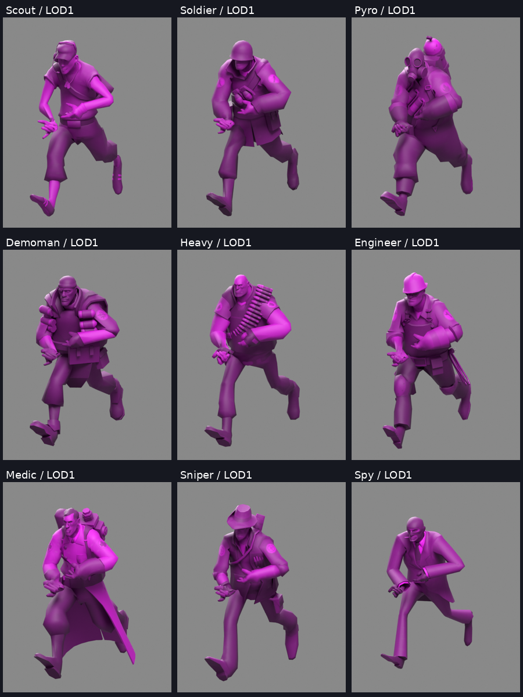
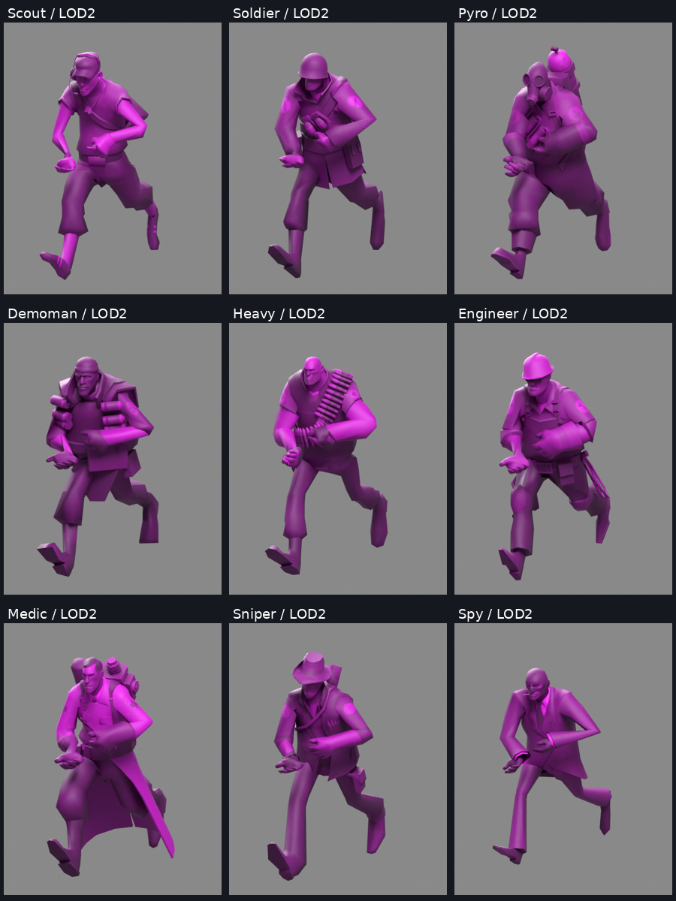
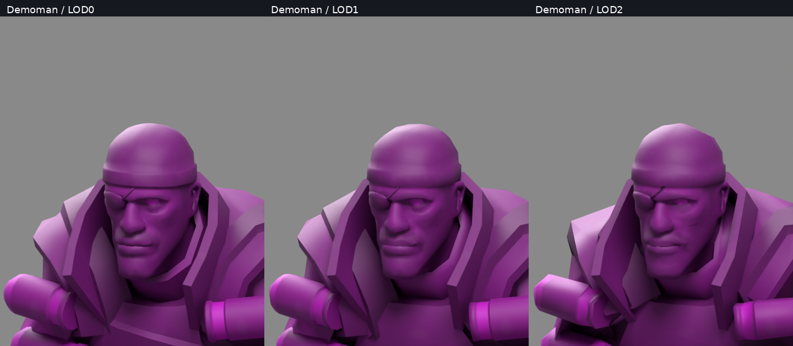

# TF2 authored world LODs

Development source now imports Valve's existing LOD0, LOD1 and LOD2 meshes for
all nine mercenaries from the user's local TF2 installation. This replaces the
previous use of the full-detail mesh at every Combat Master distance level.
It uses the authored models, not generated simplifications. Public packages
contain no Valve model, texture, animation or sound data.

The existing per-operator assignment and original/magenta choices apply to each
level. Combat Master's LODGroup thresholds, renderer membership, skeleton,
animations, scripts, collision and gameplay data remain unchanged. A renderer
shared by several levels keeps the most detailed requested source. Levels beyond
the supplied sources retain the last explicitly provided authored mesh. Missing
levels, mismatched skeletons/materials and unsupported material replacements
fail explicitly. Matching first-person arms still use their separate authored
arm sources and existing fitting path; world LODs never replace those inputs.

The reader selects the VTX LOD and its mesh-local vertex prefixes while retaining
the complete reordered VVD bank and original MDL mesh bases. This was checked
against a separate private reference that filters root-LOD fixups, rebases MDL
meshes and invokes the previous LOD0 reader. All eighteen actual lower meshes
matched its geometry, UVs, normals, materials and skin arrays. The format
references are Valve's [studio.h](https://github.com/ValveSoftware/source-sdk-2013/blob/master/src/public/studio.h)
and [optimize.h](https://github.com/ValveSoftware/source-sdk-2013/blob/master/src/public/optimize.h).
MDL53/Titanfall lower LODs are intentionally not inferred from this MDL48 result.

Lower levels reuse the detailed texture atlas when its material layout and UV
coverage permit it. Broader authored UVs retain their own tiled atlas and
material; they are never clamped. Demoman has broader authored eye UVs; his repeat pixels happen to remain
identical, allowing material sharing after retaining the correct lower UV
layout. The separate-material path is covered by an independent fixture. His
LOD2 also contains twelve zero source normals around the mouth.
Only those missing shading vectors are reconstructed from incident triangle
winding. Valid normals, positions, topology, UVs and skin weights stay intact;
missing vectors without usable incident geometry fail rather than being guessed.
The manifest records each renderer's native/source level, source hash, atlas
choice and reconstructed-normal count.

## Installer verification

Both portable candidates built successfully. The actual frozen Linux backend
and packaged Windows backend under Wine installed Scout and Demoman on separate
operator slots with different magenta settings, plus matching authored arms,
using disposable copies of real Linux-format game bundles. Their world and
first-person outputs were byte-identical across platforms. Direct serialized
UV/texture checks passed at both lower levels; original backups and both bundles
restored exactly without the TF2 source being available. This is not native
Windows game compatibility evidence. The full suite ran 222 tests: 221 passed
and one existing data-dependent test was skipped.

See the [package and transaction results](tf2-authored-lod-installer-verification.json).
Existing Lynx audio, first-person fitter and small-screen window source files
are unchanged. The user's selected operators and installed game remain unchanged.

## Verification scope

The private nine-class candidate passed serialized geometry/material/reference
checks. Every LOD0 mesh, material and texture matches the previous detailed
candidate. All nine authored first-person source arrays also match the prior
imports. The original 156 LODGroup objects are byte-identical. A subsequent
independent comparison proves the normal repair changes exactly one mesh and
only its twelve missing shading vectors.

There are 63,675 triangles across the nine detailed meshes, 41,712 at LOD1 and
27,571 at LOD2: reductions of 34.5% and 56.7%. These counts are not an FPS,
frame-time, memory or VRAM measurement.

All 27 serialized meshes were exported under the same original run frame and
exact renderer rig used by the earlier review. The nine LOD0 review inputs
matched byte-for-byte and reused their earlier images. Eighteen lower-detail
renders and three Demoman face close-ups were generated and visually inspected.
The classes remain recognizable; the reduced fingers and armor detail belong to
the authored distance meshes. Existing coat/limb intersections remain separate
quality issues.

These are offline studio renders of serialized meshes under an isolated native
clip frame, not screenshots of live game distance switching. Native runtime
material changes, transitions, full animation/grip quality, helicopter appearance
and performance remain unverified. This work does not change the user's installed
models, selections, Lynx model/audio or existing backups.

For private clip review, `python -m operators.review STAGE OUTPUT --pose clip
--clip-pose PRIVATE_WORLD_POSE --lod 1` selects the actual recorded native LOD.
Use a fresh private output directory; exported rig data must not enter public
source or installer archives. Omit `--lod` for the existing LOD0 behavior.
