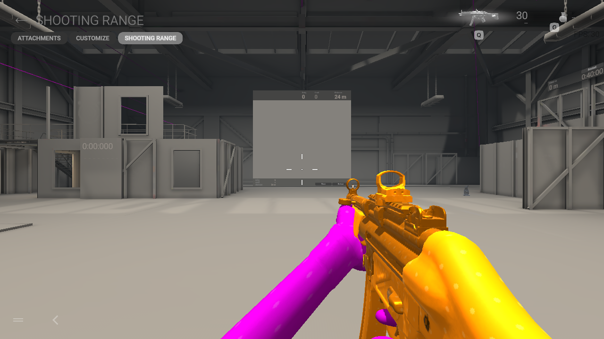
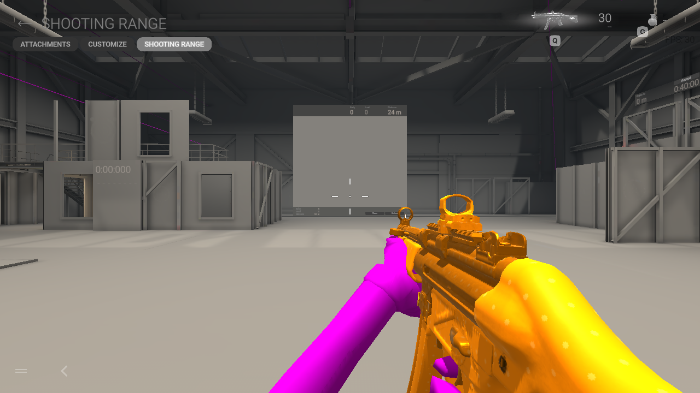
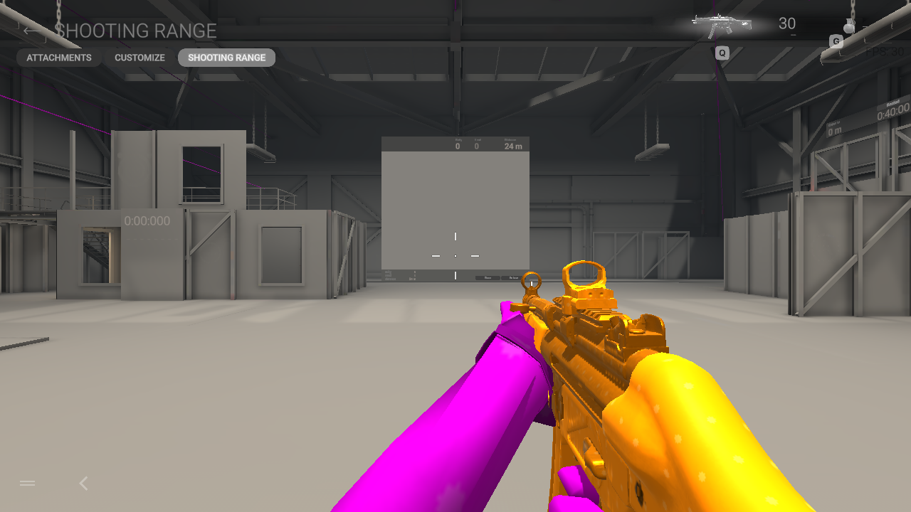
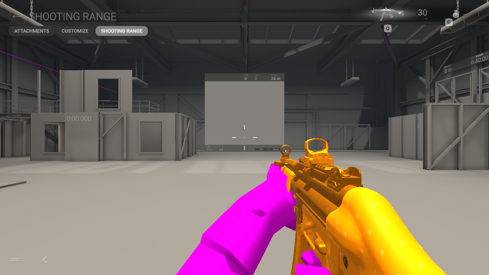
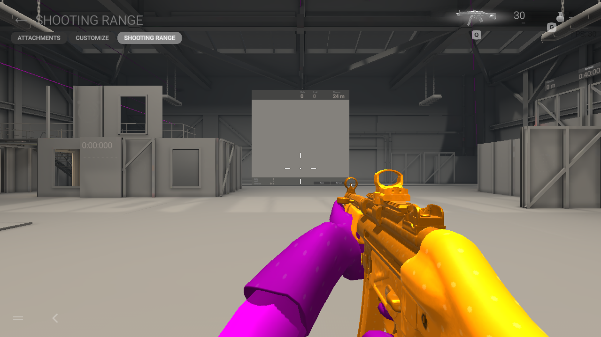

# Nine TF2 first-person options — native range review

## Genuine class-specific viewmodels, November 6

The source installer now imports the actual local `c_*_arms` model for **all
nine** selected TF2 classes when Matching first-person arms is enabled. This
replaces the previous world-body arm extraction, retaining recognizable cuffs,
gloves, hand wraps and sleeve detail. World operator models, assignments,
independent magenta controls and native animations remain unchanged. The
geometry-review captures below use original colors; TF2 magenta remains the
default and can still be disabled per model.

All nine genuine sources were reviewed in the native stationary official range:

| Model | Native capture | Fitted triangles per renderer |
|---|---|---:|
| Scout | [Taped hands](screenshots/tf2-scout-authored-viewmodel-range-nov6.png) | 4,482 |
| Soldier | [Sleeve and hand](screenshots/tf2-soldier-authored-viewmodel-range-nov6.png) | 4,074 |
| Pyro | [Glove and cuff](screenshots/tf2-pyro-authored-viewmodel-range-nov6.png) | 2,804 |
| Demoman | [Wrapped forearm](screenshots/tf2-demoman-authored-viewmodel-range-nov6.png) | 3,362 |
| Heavy | [Glove and bare forearm](screenshots/tf2-heavy-authored-viewmodel-range-nov6.png) | 5,244 |
| Engineer | [Bare left forearm](screenshots/tf2-engineer-authored-viewmodel-range-nov6.png) | 3,912 |
| Medic | [Genuine glove, November 5](screenshots/tf2-medic-authored-viewmodel-range-nov5.png) | 2,880 |
| Sniper | [Watch and glove](screenshots/tf2-sniper-authored-viewmodel-range-nov6.png) | 3,332 |
| Spy | [Pinstripe sleeve and glove](screenshots/tf2-spy-authored-viewmodel-range-nov6.png) | 3,880 |

Each keeps the center clear in the captured hipfire view. This does not prove
finger contact across weapons, movement, ADS, reloads, helicopter views or 4K
performance. The deliberate 30-FPS test cap is not a benchmark. All nine native
games exited 0 and retained the host profile; Gamescope teardown returned 139.
Only menu navigation and capture controls were used.

Arm-only sources now receive two explicitly virtual, **unweighted** bookkeeping
references derived from their actual arm segments. They never become native
skin bones. Five classes have different world/viewmodel proportions, so their
world pose is not assumed. Authored geometry, bind rotations and skin arrays
remain exact. For Scout, Heavy, Medic and Sniper the resulting fitted positions,
normals, UVs, faces and weights are exactly equal to the prior verified-frame
method. The actual installer library reproduces all nine prepared sources.
Missing, invalid or wrong-class sources fail explicitly, with no body-arm
fallback. Disabling Matching first-person arms avoids the arm import entirely.

[The evidence index](tf2-authored-arms-verification.json) records native captures,
bundle hashes, preservation checks and real local-import comparisons. The source
suite runs 164 tests, with 163 passing and one existing data-dependent skip.
Public v0.1.5-preview packages predate this all-class upgrade; their genuine
viewmodel import covers Medic only. The sections below retain earlier controls.

A separate native Scout check confirms the default magenta appearance on the
upgraded source alongside the existing gold weapon. Fresh Linux and Windows
installer candidates contain the matching source modules. The actual frozen
Linux backend applied a Scout world/viewmodel selection to disposable copies
of two real original bundles, produced a first-person bundle byte-identical to
the reviewed candidate, then restored both originals exactly without needing
the TF2 source. Eleven focused tests passed in the packaged Windows runtime
under Wine; native Windows game testing remains open.
[Package hashes and checks](tf2-authored-arms-installer-verification.json) also
record unchanged hashes for all 81 installed bundles and all 81 original backups.

## Earlier world-arm extraction review

All nine optional mercenary arm models rendered in the native Linux game's
**official MP.V Shooting Range** on November 5. These are screenshots, not
software renders. The source models come from the user's local Team Fortress 2
installation; MWC does not distribute Valve model or texture binaries.

Each test used a separate private Ranger **first-person-only alias**, a copied
offline profile, read-only installed game files and one staged first-person
bundle. The installed Ranger remains the magenta armored human Grapple pilot;
Dozer remains Shrek. These QA aliases never changed the user's assignments.
Matching arms and each model's color remain controlled by the existing installer.

| Optional model | Stationary observation | Native capture |
|---|---|---|
| Scout | Slim forearms and taped glove/cuff visible; center stays clear. | [Scout](screenshots/tf2-scout-private-range-nov5.png) |
| Heavy | Larger glove and forearm visible without covering the center. | [Heavy](screenshots/tf2-heavy-private-range-nov5.png) |
| Soldier | Broad sleeve and hand visible; center stays clear. | [Soldier](screenshots/tf2-soldier-private-range-nov5.png) |
| Medic | Upgraded actual first-person glove; prior forearm patch absent in this stationary view. | [Medic upgrade](screenshots/tf2-medic-authored-viewmodel-range-nov5.png) |
| Engineer | Long glove visible; center stays clear. | [Engineer](screenshots/tf2-engineer-private-range-nov5.png) |
| Sniper | Watch/cuff and glove visible; center stays clear. | [Sniper](screenshots/tf2-sniper-private-range-nov5.png) |
| Spy | Suit sleeve and glove visible; center stays clear. | [Spy](screenshots/tf2-spy-private-range-nov5.png) |
| Demoman | Glove and forearm visible; small dark upper-forearm mark retained for review. | [Demoman](screenshots/tf2-demoman-private-range-nov5.png) |
| Pyro | Broad glove/cuff visible; center stays clear. | [Pyro](screenshots/tf2-pyro-private-range-nov5.png) |

The range's own menu controls were used to enter. No movement, firing, ADS,
reload, reward claim, purchase or unlock inputs were sent. Each native game
exited with code 0 and the host profile stayed byte-identical. Gamescope returned
139 during teardown, so these runs do not establish clean compositor shutdown
or general stability. The display was 1280×720 with a deliberate 30-FPS cap;
that label is not a performance measurement.

The staged bundles round-tripped exact geometry/UV/skin data, retained original
skeletons/animations/collision and preserved all unrelated original objects.
[The evidence index](tf2-first-person-verification.json) records bundle and
capture hashes, process results and the limited verification scope. Source
triangle/normal comparisons are diagnostic only: a normal disagreement can
occur near fitted fingers and does not by itself prove a visible hole.

Full grip quality across all weapons, ADS, reloads, movement, helicopter scenes,
all LOD/attachment combinations and 4K performance **remain unverified**.
Fishguy retains a separate unresolved angular wrist in the native range. The
rejected direct hand-driver remap and nearest-native-weight experiment are not
part of these TF2 builds or an installed update.

## Medic forearm control

A second private native test replaced **only the authored albedo image bytes**
with a uniform opaque magenta image. All meshes, normals, weights, materials,
bones, animations and unrelated objects remained byte-identical. The dark
triangular forearm mark remains visible. That rejects an albedo-only explanation;
it does not yet distinguish surface deformation, skinning and shading. This
control was not installed or added as a selectable mod. Its native game exited
0, Gamescope exited 139 during teardown and the original profile stayed exact.

The local TF2 VPK also contains genuine class-specific first-person arm models,
including Medic's 2,880-triangle arm mesh. The current extraction from his world
model yields 916 arm triangles. The source installer now uses that genuine first-person model for Medic when
Matching first-person arms is enabled. Other TF2 classes retain their existing
world-arm extraction; their separate first-person sources are not enabled by this change.

Source regression checks: 149 tests ran, 148 passed and one existing data-dependent
test was skipped. Both Linux and Windows installer frontends compiled with the
updated native weapon thumbnails. Compilation is not native Windows validation.

## Medic actual first-person source integration

The higher-detail authored glove no longer shows the prior triangular forearm
patch in this stationary hipfire view. Its open cuff is part of the source model.
This is not full finger, animation, ADS or reload acceptance.

The existing independent Matching first-person arms option imports
`models/weapons/c_models/c_medic_arms` from the user's local TF2 VPKs. Medic's
world model remains the existing local player model. Two unweighted fit landmarks
come from that same class's world rig after checking the common arm coordinate
frame; no geometry is generated and the authored arm bind rotations and skin
influences are retained. A mismatched class/frame fails before installation.
The extra source is imported only when Medic and matching arms are selected.

The integrated source pipeline produced a bundle **byte-identical to the private
native-tested prototype**. World-model source geometry, UVs, skin and bind data
remain exact. The first-person build retains 144,988 unrelated original objects
and all original animation/skeleton/collision assets. See
[the integration verification](medic-first-person-verification.json). No user
installation or default operator assignment was changed by this work. Public
v0.1.4-preview packages predate this source improvement.

Four focused source-preservation/rejection tests also passed in the Windows
embedded Python 3.12.10 runtime under Wine. That is runtime compatibility evidence,
not native Windows game acceptance. The source Linux installer displayed its
updated Lynx and Scorpion native thumbnails in an isolated 1280×720 check; no
Apply action or installation-state change was made.

Fresh Linux and Windows development installer candidates were built from source
`42826b7`. Linux's frozen backend diagnostics pass; four focused tests pass using
the new Windows package's own source and embedded runtime under Wine. Both
contain the new helper and native thumbnails and omit local TF2/audio/archive
content and the rejected hand experiment. Their [hashes and packaging checks](medic-installer-candidate-verification.json)
are recorded separately. They have not replaced the public v0.1.4-preview release
or the user's existing personal installer.
