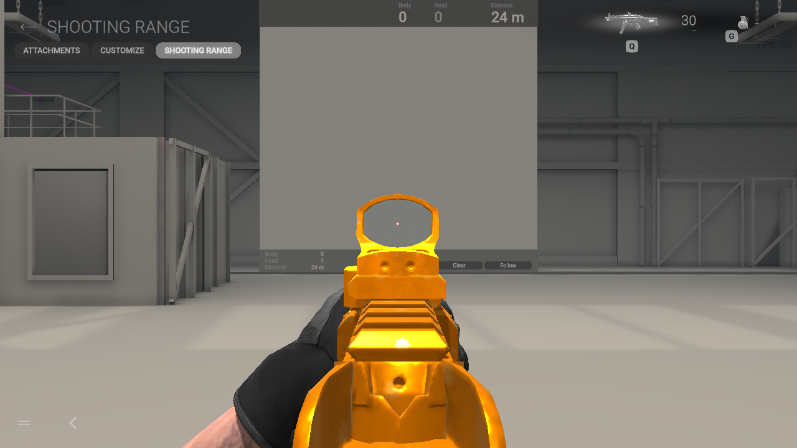
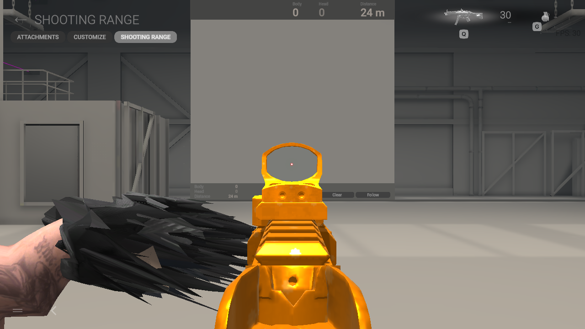
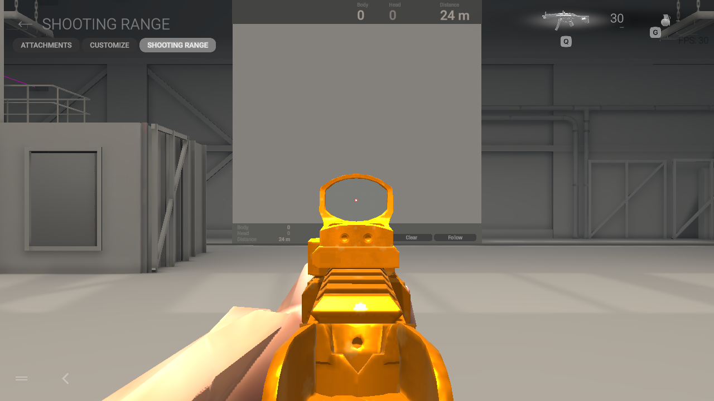

# Variable skin weights: verified format, unresolved authored fitting

The experimental codec in `operators/variable_skin.py` can preserve a full
weight field instead of discarding every influence after the fourth. It is not
enabled by the installer. The production four-weight writer, accepted fingertip
corrections, native rigs and installed game remain unchanged.

Unity documents variable bone counts, descending weight order and at least
16-bit normalized precision in
[Mesh.SetBoneWeights](https://docs.unity.com/en-us/engine/6000.3/script-reference/unityengine/mesh/setboneweights).
Its [quality cap](https://docs.unity.com/en-us/engine/6000.3/script-reference/unityengine/qualitysettings/skinweights)
can leave some stored influences unused. API support alone did not establish
that the Combat Master renderer consumed this data, so the checks below used
both a separate Editor oracle and the actual native player.

## Independent serialization oracle

A separate Unity 6000.6.5f1 project generated an MWC-owned three-vertex reference
with 1, 4 and 8 influences. The codec reproduces its packed words and float32 API
readback exactly. A separately written Python asset changed the counts to 1, 5
and 7; Unity imported it and returned those exact distributions. Unlimited CPU
skinning matched independently multiplied pose/bind matrices to 1.1921e-7 m.
The intentionally capped four-weight control differed by 0.012891 m.

The observed `m_VariableBoneCountWeights.m_Data` encoding is a UInt32 list.
The first `vertex_count + 1` words contain absolute offsets within that list.
Each remaining word packs a UInt16 bone index in its low half and a UNorm16
weight in its high half. Each row sums to 65535. The codec retains the full
field, writes a separately normalized top-four fallback, and computes bone
bounds from every retained influence. The current mesh-buffer writer still
limits the renderer to 256 bone references; the standalone codec supports the
UInt16 index boundary.

Eight focused tests cover actual Editor reference values, malformed fields,
index limits, serialized geometry/skin readback and a bone present only beyond
the top-four fallback. The public writer additionally reproduces both private
Fishguy candidate meshes byte-for-byte. That is serialization evidence, not
visual acceptance. The own reference asset, C# source and API results are in
`tests/fixtures/variable-skin`; no game meshes are included there.

## Native extra-influence controls

Two weak controls loaded the format, but their small extra mass did not give a
sufficiently clear visual distinction. Stronger controls kept the identical
native arm geometry and original four-weight fallback while splitting weights
across aliases of existing bone references. Four small helper influences then
received 10.4–47.4% of the full field. The top four retained the original
logical deformation within 2.462e-5 weight error. No Transform or animation was
added or edited.

With the original quality cap the native arm remained clean. With only the
private quality cap changed to 255, the identical mesh visibly deformed under
the extra field. This establishes native activation of influences beyond the
fallback; native numerical matrix accuracy was not measured. The intentionally
distorted control is not a proposed replacement model.

The quality control modified only the two `skinWeights` values in a private
copy of `CombatMaster_Data/data.unity3d`. It retained 11,743 unrelated objects,
eight other container entries and every container entry flag byte-for-byte.
It was mounted read-only inside the isolated test; the installed file was not
replaced. This global control is not integrated into installer transactions and
has no performance acceptance.

[Hashes, terminal results and exact limits](variable-skin-native-verification.json)
record the controls. All four native game processes exited with code 0 and
retained host profile hashes. Gamescope teardown separately returned 139.
The observations cover stationary MP.V hipfire/ADS at 1280×720, not reloads,
movement, helicopter scenes, other weapons or Windows gameplay.

## Authored fitting results

The first full-field Fishguy candidate combined the gradual rest-shape flow with
the previous anatomical sampler. It built with at most six influences and no
four-weight truncation, but still produced severe forearm spikes in the native
player. A self-sampling check then exposed bias in that sampler: on the native
bare arms themselves its artificial hand/forearm blend changed weights by up to
0.3325 and 0.3509 in total absolute difference for the two LODs.

Sampling the closest surface from the bare-hand/forearm union reproduces the
visible native LOD's original field within 5.97e-8. The other LOD retains one
ambiguous vertex at 0.3226 total absolute difference. An intermediate attempt
to treat metacarpals as distal finger families worsened this self-check and was
rejected before native testing.

Two subsequent native candidates used the corrected union sampler, first with
the gradual rest flow and then with the current production rest shape and
fingertip fit. The flow still distorted severely. Retaining the production rest
shape reduced that distortion, but a forearm opening remained. Neither is
accepted or installed. Correct serialization and a better surface sampler do
not establish that the authored rest shape deforms correctly under the animated
native field. Further work must address that consistency instead of changing
the rig or hiding the defect by dropping weights.

[Candidate hashes, self-checks and runtime results](fish-variable-skin-candidate-verification.json)
record the three rejected builds. Each retained 144,988 unrelated original
objects and the native skeleton, animations, scripts and collision. Each native
game exited with code 0 and retained host profile hashes; Gamescope teardown
separately returned 139. These experiments leave the Lynx cat/audio, installer
state, installed operator assignments and released v0.1.9 packages unchanged.
