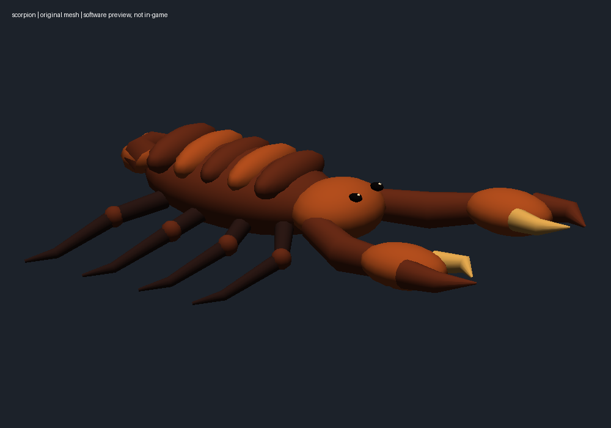
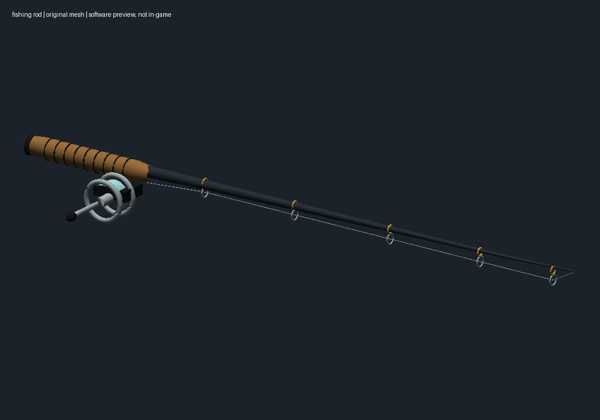
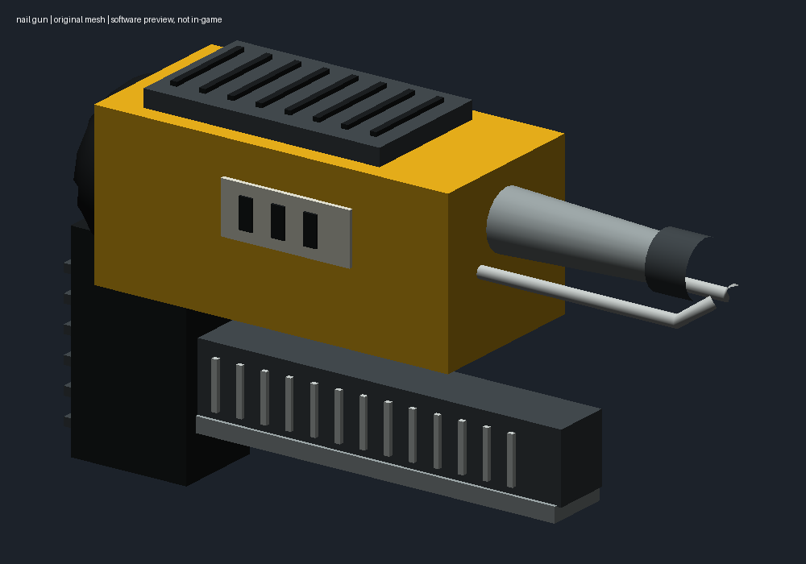
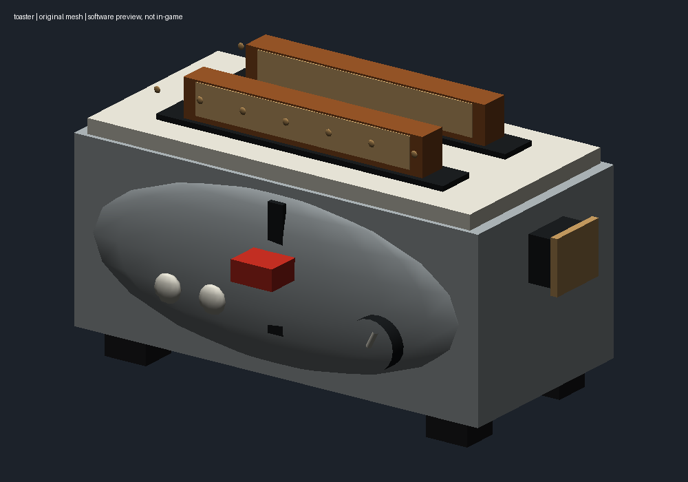

# Four original weapon models

These are original code-built cosmetic meshes. No model files from another
game or an untrusted download were used. Their code, palettes and exported
OBJ/GLB assets are covered by this project's MIT license.

| Weapon | Replacement | Vertices | Triangles |
| --- | --- | ---: | ---: |
| Scorpion Evo | Scorpion with pincers, eight legs and low lateral tail curl | 3,014 | 5,572 |
| Kar98k | Cork-handled fishing rod with reel, crank, guides and line | 4,140 | 7,676 |
| MP7 | Yellow industrial nail gun with nail magazine and safety nose | 1,260 | 1,068 |
| P90 | Two-slot toaster with bread, lever, browning dial and feet | 1,404 | 2,104 |

## Software previews

These renders show generated geometry and palettes. They are not game captures
and do not establish in-game position, occlusion or animation quality.









Each folder under assets/weapon-models contains an OBJ, MTL, palette, standalone
GLB, preview and mesh-info.json. GLB coordinates are converted to standard Y-up;
source OBJ coordinates are Z-up with +Y forward. The Unity visual child maps
source +Y forward to weapon +Z forward, and source +Z up to weapon +Y up.

## Build and install

Configure the supported game build first, then choose models in
weapon-models.json. Set each model's enabled flag independently. Restore an
installed model layer and choose fresh output/backup paths before changing
that selection; do not build on an already-installed model layer.

```sh
.venv/bin/python weapon_models_cli.py models
.venv/bin/python weapon_models_cli.py prepare
.venv/bin/python weapon_models_cli.py build
.venv/bin/python weapon_models_cli.py verify
.venv/bin/python weapon_models_cli.py install --dry-run
.venv/bin/python weapon_models_cli.py install
.venv/bin/python weapon_models_cli.py restore
```

Prepare records the current intended baseline hashes without editing game
files. Build/deployment check those hashes and the game build. The local
baseline includes the M1A0 ginger cat and sight changes; restoring models
returns those exact previous weapon bundles. Audio and helicopter/blue-crate
bundles are not touched.

## Implementation and verification

The model layer affects src/weapons/weapons and src/weapons/attachments only.
Separate visible mesh/material/palette objects are added to inspected weapon
visual roots: two each for Scorpion, MP7 and P90, and three Kar98k variant roots.

Private weapon MeshFilter/SkinnedMeshRenderer bindings receive dedicated empty
visual copies, and private renderers are disabled, including initially empty
renderers that the game populates at runtime. Shared scopes, iron sights and
connector visuals are retained. Existing transforms, bones, attachment/muzzle
nodes, original mesh objects, colliders, audio, animations, scripts, weapon
stats and network data are unchanged. Original mesh data remains available to
any nonvisual references.

New child links and visual mesh/renderer fields are the only permitted changes
to existing objects. Every other original object must remain byte-exact. The
serialized output is reopened; new geometry/normals/UVs/indices and palette
pixels match exactly, new local references resolve, and added masking meshes
have zero visible vertices. Independent geometry/export tests check valid
triangles and normals and correctly embedded GLB images/buffers.

## Current limitations and acceptance checks

These are installed rigid prototypes, not separately rigged/animated animals
or tools. Existing hands keep their weapon animations; the reel crank,
scorpion legs, bread and nail magazine do not have new motion tracks. Reload
appearance may look odd. Shared optics or interchangeable parts can remain
visible and need inspection with each loadout.

The user requested implementation rather than the additional in-game test
pass. No game-visible success or performance improvement is claimed.

In an offline or explicitly authorized environment, check each model in the
armory, hipfire and ADS; firing/reload/inspect; first and third person; and
attachment/LOD variants. Check for center-screen occlusion, clipping, remaining
old parts and muzzle placement. No gameplay setting should need changing.

Restore this layer before restoring sights or the cat. See the complete
[rollback order](restoration.md).
