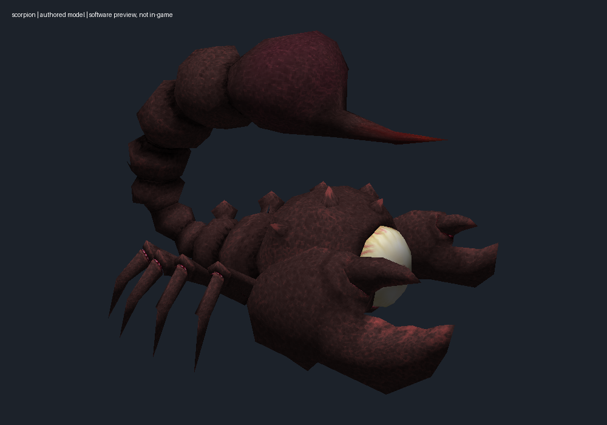
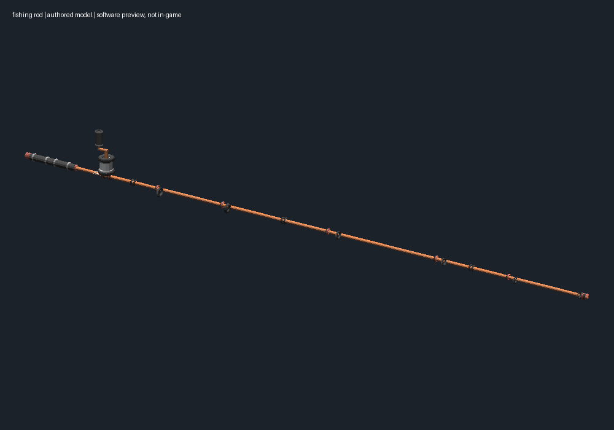
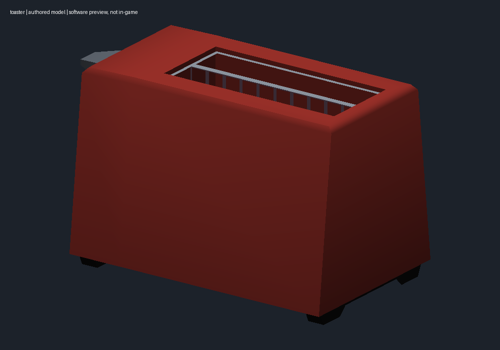

# Weapon visual replacements

Scorpion Evo, Kar98k and P90 now use authored imported assets. The MP7 now uses Liberi Arcano's proper authored Poons power nailer, replacing its earlier procedural placeholder. The Lynx cat and meowing audio are not rebuilt by this upgrade.

| Weapon | Visual | Source | State |
|---|---|---|---|
| Scorpion Evo | Textured scorpion | Guillaume "GuieA_7" Englert / CC BY-SA 4.0 | Native offline armory rendering verified; ADS/reload/LODs pending |
| Kar98k | Fishing rod and reel | Justin Randall / CC BY 3.0 | Native offline armory rendering verified; ADS/reload/LODs pending |
| P90 | Textured toaster | MilkAndBanana / CC0 | Native offline armory rendering verified; ADS/reload/LODs pending |
| MP7 | Poons power nailer | Liberi Arcano / CC BY 4.0 | Native offline armory/showcase rendering verified; ADS/reload/LODs pending |
| Minigun | Actual TF2 Medigun | User-owned local TF2 installation; no Valve data bundled | Installed/file-verified; Kill Chains menu only has a static image, world appearance untested |

These are software previews, not game captures. Read the [expansion report](expansion.md) for source links, tests and remaining work, and [asset attribution](../assets/authored-weapons/ATTRIBUTION.md) for licenses.

Each accepted model keeps its original geometry, UVs and material colors through a checked atlas and uniform coordinate fit. `weapon_models/imported.py` verifies asset hashes; `weapon_models/bundles.py` adds visual mesh/material/texture objects and masks only the owning weapon's original renderers. Optics/aim transforms, original materials, animations, scripts, collision and weapon statistics are not replaced. Source mesh sizes above the existing uint16 writer's limit fail explicitly.

The manager cards install independently. `config/weapon-asset-selections.json` makes the retained MP7 source explicit. Legacy procedural exports remain available for old manifest verification and rollback; missing imported assets never silently trigger procedural generation.

For standalone development, configure a local game preset, record the baseline with `weapon_models_cli.py prepare`, then `build`, `verify`, and `install`. Do not install a standalone old stage over other selected mods: use the manager's composition and transaction engine. `restore` returns a standalone layer to its recorded preceding baseline and refuses unknown hashes. It never closes a running game.

November 3 native menu checks confirmed all four authored replacements render, and the existing M1A0 Lynx cat retains its rear body and full tail. The P90 showcase camera mostly sees the toaster's plain side, so this is limited appearance evidence. Source geometry and gold native attachments remain separate. Raised/rolled placement still needs first-person inspection. See [actual capture gallery](screenshots/README.md).
