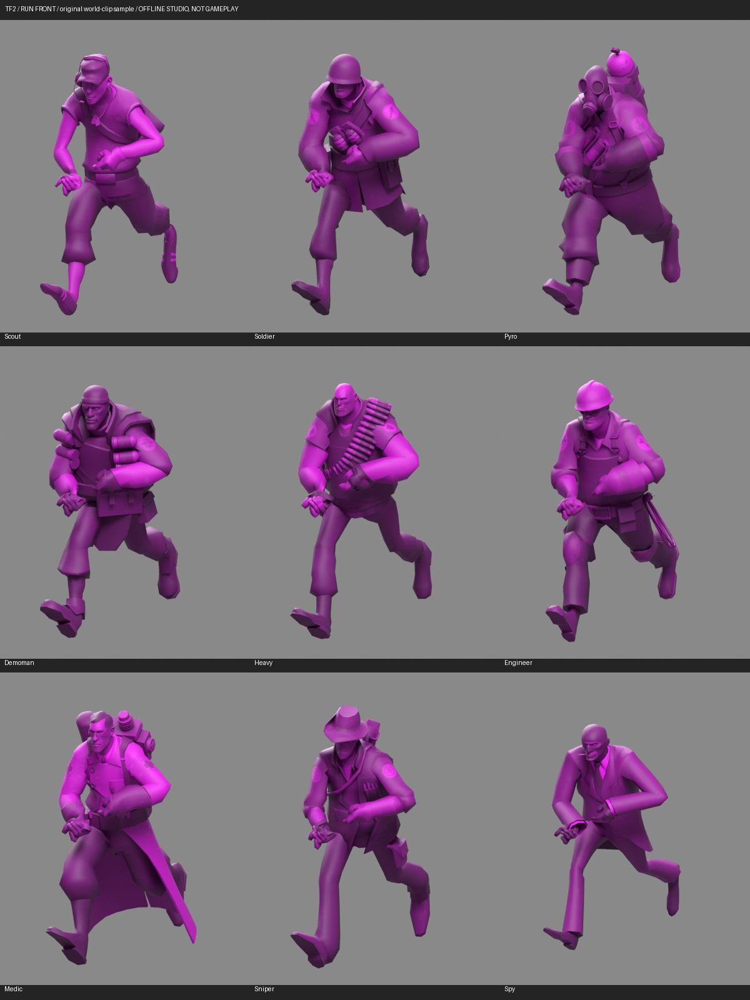
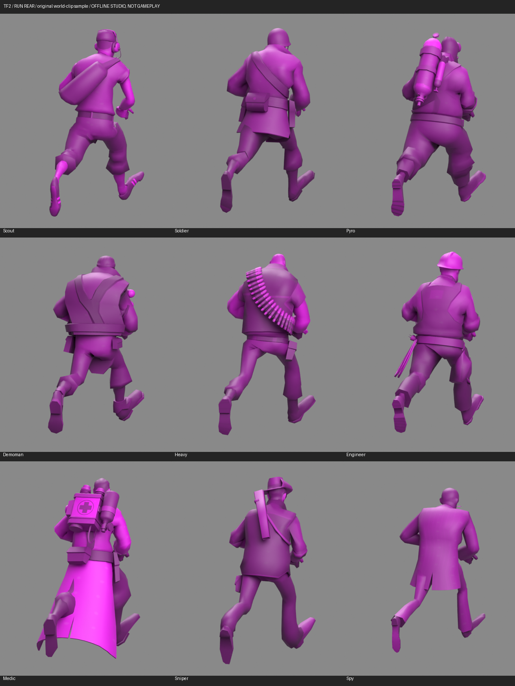
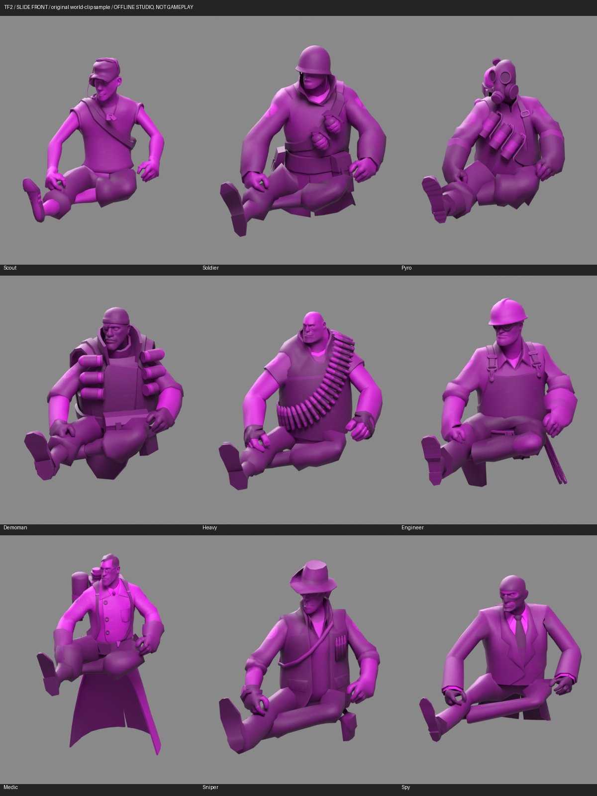
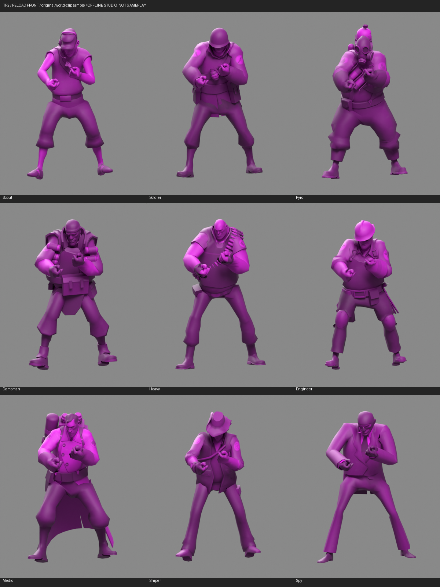

# Serialized TF2 world-model clip review

The current production builder generated all nine local TF2 mercenary choices
in one private original-bundle copy, using the existing magenta appearance.
The builder verified serialized geometry/UV/skin round trips, references and
the permitted visual-field changes; all other original objects remained
byte-identical. The diagnostic roster uses slots 4–12. It was **not installed**
and does not change the user's saved assignments or normal operator models.

The new `operators.review --pose clip --clip-pose DIRECTORY` path reads each
actual serialized replacement under its exact original operator rig. All nine
classes passed source/hash, renderer, bone-order and inverse-bind matching for
three isolated frames: `MP5_Run` frame 9, `MP5_Slide_Loop` frame 8, and
`MP5_Reload` frame 28. Only the main LOD0 renderer was visually reviewed; other LODs retain their
build checks and require separate visual acceptance. The 27 samples produced
36 reviewed studio views: three
front views and a rear run view per class. These are sampled original transform
clips, not a complete animation or controller evaluation. The earlier native
Unity oracle verifies the reader's reviewed curve conventions; it does not
prove live-game behavior for these nine classes.

The source suite passes **205 tests: 204 passed and one existing data-dependent
skip**. Ten focused input/space tests include an independently calculated
two-bone deformation and reject corrupted hashes, wrong operators/sources,
reordered bones, mismatched binds, missing world frames and invalid matrices.
The new clip path explicitly resolves LOD0 from the reviewed target index,
rather than taking the first renderer by asset ID. That exposed an older
review-tool ambiguity for Soldier, Demoman and Engineer. All 27 corrected
LOD0 exports happened to retain byte-identical render arrays and materials
to the earlier samples because the current replacement builder duplicates
the same detailed source mesh across these LOD renderers. The 36 existing
PNG views were reused only after those exact comparisons; no new render runs
are claimed for the LOD0 follow-up. This does not validate actual distance
switching or LOD performance.

Real staged-input controls also rejected a corrupted blob and an absent
operator before creating review output. All nine previous default bind
previews remain byte-identical to the earlier committed exporter.

## Observed appearance and remaining issues

The recognizable class silhouettes and magenta appearance are visible in the
reviewed frames. Helmets, hats, masks, backpacks and the Heavy's bandolier are
present. This is a presence/pose review, not clearance certification: there are
no weapon meshes in these images, so hand-to-weapon grip is not tested.

The Medic's long coat remains too rigid in the slide sample and intersects the
legs in some views. Source inspection confirmed the secondary coat helpers
currently inherit `Root_M`. The Sniper's jacket/leg clearance and the bulky
classes' sleeve/hand clearance also need further work. These findings remain
open; none of the screenshots establishes correct full animations, native
materials, first-person appearance, helicopter placement or performance.

## Coat experiments remain unaccepted

A private experiment remapped eight lower front/back coat helpers to the
corresponding hips, preserving exact rest geometry, UVs, materials, native
animation and all unrelated weights. It changed 629 vertices with at most
three active influences and no dropped mass. Six front/rear candidate views
were rendered; the full mapping visibly folds the coat too aggressively.
Quarter/half blends worsened measured run and slide crossings. A narrower
front-only control affected 369 vertices; its quarter blend preserved the
slide crossing total but worsened run, while stronger blends also worsened
other samples. None is accepted, added to the production fitter or installed.

The strict checker measures noncoplanar interior crossings in a fixed
cloth/leg focus mesh. It excludes welded adjacency and coplanar/boundary-only
contact; it is not a complete collision proof. Different focus meshes have
different baseline counts and must not be compared directly. Distances use
the evaluated world-to-studio coordinates, never the bind mesh's unit scale.
The initial bind-unit-divided distance report was rejected and corrected;
reviewed geometry/images were unaffected. [Experiment evidence](medic-coat-experiment-verification.json)
records these limits and the rejected approaches.

## Limits and preservation

The samples use private copies of the original native Linux assets and the
current serialized replacement bundle. Original animations, skeletons,
controllers, collision, scripts, gameplay values and the installed game are
unchanged. No game process, events, controller blending, runtime IK or network
traffic is used. The render uses a simple Blender studio material rather than
the native Unity shader. Full locomotion/ADS/reload, actual weapon handling,
helicopter and native game acceptance remain pending.

Valve's models/textures came from the existing local TF2 import. No Valve
source assets or original Combat Master meshes, clips, skeletons or pose
arrays accompany this report; private rig data must remain outside public
source/packages. See [TF2 credits](../assets/operator-sources/ATTRIBUTION.md)
and the existing local-import workflow. MWC's code license does not grant a
license to Valve assets.

The new developer review commands are newer than the v0.1.12 portable
packages. Installer behavior, saved selections and existing game mods remain
unchanged. [The verification record](world-serialized-clip-review-verification.json)
contains hashes, exact test scope and remaining limits.
